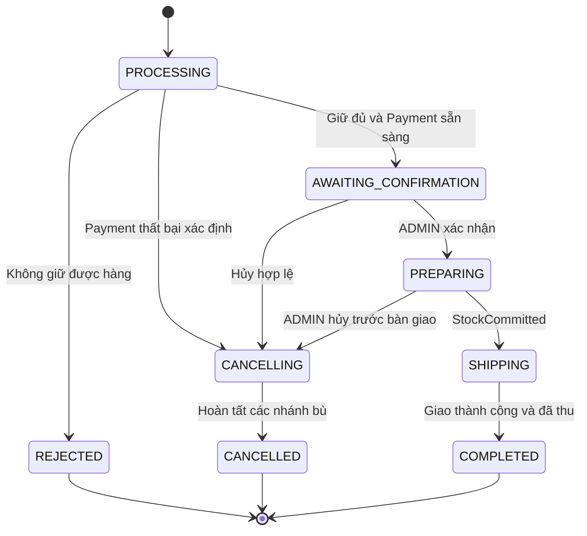

# Thiết kế luồng xử lý và trạng thái

Phiên bản 0.1. Nguồn dữ liệu: Order sở hữu đơn/workflow, Inventory sở hữu reservation và lượng kho, Payment sở hữu tiền. Tham chiếu [DB](MO-TA-HE-THONG.md), [message](contracts/MESSAGES.md).

## 1. Trạng thái đơn



Workflow đang DISPATCH/COMPLETION không đổi ngay orders.status; nó khóa thao tác xung đột và UI hiển thị đang bàn giao/hoàn tất. Chỉ SHIPPING sau StockCommitted. Lỗi kỹ thuật không tự chuyển REJECTED/CANCELLED.

## 2. Điều kiện chuyển

| Thao tác | Điều kiện | Kết quả |
| --- | --- | --- |
| Tiếp nhận | StockReserved + COD initialized hoặc mô phỏng paid | AWAITING_CONFIRMATION |
| Xác nhận | AWAITING_CONFIRMATION, workflow không bận | PREPARING |
| Khách hủy | Chủ đơn, AWAITING_CONFIRMATION, không bận | CANCELLING |
| ADMIN hủy | AWAITING_CONFIRMATION/PREPARING, chưa dispatch | CANCELLING |
| Bàn giao | PREPARING, không bận, payment hợp lệ | Chờ CommitStock rồi SHIPPING |
| Hoàn thành COD | SHIPPING, xác nhận giao và thu | Chờ CodCollected rồi COMPLETED |
| Hoàn thành mô phỏng | SHIPPING, payment SUCCEEDED, đã giao | COMPLETED |

UPDATE có điều kiện theo status/version; chỉ một thao tác cạnh tranh được chấp nhận. Lệnh bù dùng mã ổn định lưu trong workflow. Không reset bước thành công để chạy lại toàn bộ Saga.

## 3. Checkout mô phỏng

```mermaid
sequenceDiagram
    participant U as Frontend
    participant O as Order
    participant C as Catalog
    participant I as Inventory
    participant P as Payment
    U->>O: POST quote
    O->>C: Batch sản phẩm và giá
    O-->>U: Giá và phí hiện tại
    U->>O: POST orders + key + giá xác nhận
    O->>C: Kiểm tra lại giá/trạng thái
    Note over O: Transaction đơn, workflow, key, outbox
    O-->>U: 202 + orderId
    O->>I: ReserveStock qua broker
    I-->>O: StockReserved
    O->>P: ProcessPayment
    alt Thành công
        P-->>O: PaymentSucceeded
        Note over O: AWAITING_CONFIRMATION
    else Thất bại
        P-->>O: PaymentFailed
        O->>I: ReleaseStock
        I-->>O: StockReleased
        Note over O: CANCELLED, lý do PAYMENT_FAILED
    else Chậm
        Note over O,P: Giữ PROCESSING/PENDING; đối chiếu cùng paymentId
    end
    U->>O: GET orders/id
    O-->>U: Trạng thái đơn và tiền
```

Với COD thay ProcessPayment bằng InitializeCodPayment, chờ PaymentInitialized. Không giữ được hàng thì REJECTED, không tạo payment. PaymentFailed đã xác định không cần RefundPayment; hủy lúc đó chỉ cần giải phóng hàng và ghi nhánh tiền FAILED đã kết thúc.

## 4. Hủy một đơn đã trả

```mermaid
sequenceDiagram
    participant U as Khách / ADMIN
    participant O as Order
    participant I as Inventory
    participant P as Payment
    U->>O: Cancel + lý do
    Note over O: Kiểm tra quyền, status/version; CANCELLING
    O-->>U: 202, đang hủy
    par Giải phóng kho
        O->>I: ReleaseStock
        I-->>O: StockReleased
    and Hoàn mô phỏng
        O->>P: RefundPayment
        P-->>O: PaymentRefunded
    end
    Note over O: Hai nhánh hoàn tất mới CANCELLED
```

Nếu refund lỗi: kho có thể đã RELEASED; tiếp tục refund cùng operationId, không giữ hàng lại hoặc hoàn kho thêm. COD dùng CancelCodPayment. Refund thất bại đặt cờ cần xử lý, giữ REFUND_PENDING/CANCELLING.

## 5. Kho và thanh toán

Reservation: RESERVED → RELEASED hoặc COMMITTED, không chuyển lại. Giữ cập nhật reserved; xuất giảm cả on_hand và reserved. Giải phóng giảm reserved. Cùng transaction gồm counters, reservation, movement, operation result, inbox và outbox.

Payment mô phỏng: PENDING → SUCCEEDED hoặc FAILED. COD: AWAITING_COLLECTION → SUCCEEDED hoặc CANCELLED. Mô phỏng SUCCEEDED → REFUND_PENDING → REFUNDED. Refund lỗi giữ REFUND_PENDING và retry; không FAILED ngược về payment đã thu. Mọi event trạng thái có paymentVersion; Order bỏ qua phiên bản cũ và đối chiếu khi thấy khoảng trống không giải thích được.

## 6. Phục hồi và tình huống lỗi

| Điểm lỗi | Cách phục hồi | Điều cấm |
| --- | --- | --- |
| Client mất phản hồi sau tạo đơn | Gửi lại cùng key/payload, nhận cùng orderId | Tự sinh key mới |
| Commit DB rồi chết trước publish | Worker gửi bản ghi outbox | Sửa DB tay để “gửi lại” |
| Publish rồi chết trước đánh dấu | Publish lại cùng messageId; inbox dedup | Giả định exactly-once |
| Xử lý rồi chết trước ACK | Nhận lại; đọc inbox và bỏ qua thực thi | Trừ/hoàn/thu lại |
| Payment không phản hồi | Tra cứu theo orderId, giữ chưa xác định, cảnh báo quá hạn | Coi timeout là FAILED |
| Hủy và bàn giao cùng lúc | Status/version/workflow quyết định một bên thắng | Cho RELEASE và COMMIT cùng thành công |
| Event cũ/không hợp lệ | Kiểm tra version, phase, operationId; ghi log, đối chiếu | Hồi sinh đơn kết thúc |
| Broker ngừng | Outbox giữ việc; UI cho tra cứu trạng thái | Báo thành công nghiệp vụ chỉ vì lưu outbox |
| Message lỗi dai dẳng | Retry giới hạn rồi DLQ/cảnh báo; kiểm tra trước replay | Bỏ message và coi xong |

Mốc đề xuất để demo: polling frontend 2 giây tăng dần tối đa 10 giây; sau 2 phút dừng polling tự động nhưng có nút cập nhật. Backend cảnh báo workflow không tiến triển sau 5 phút; đây là cảnh báo, không hủy tự động. Retry vận chuyển tối đa 5 lần trước DLQ, backoff có cấu hình. Các con số cần đo và điều chỉnh; worker phục hồi vẫn chạy sau khi trình duyệt ngừng polling.

Mỗi log cần service, requestId/correlationId, orderId, operationId/messageId khi có, bước và mã lỗi. Không log mật khẩu, token, toàn bộ địa chỉ hoặc payload người nhận.
