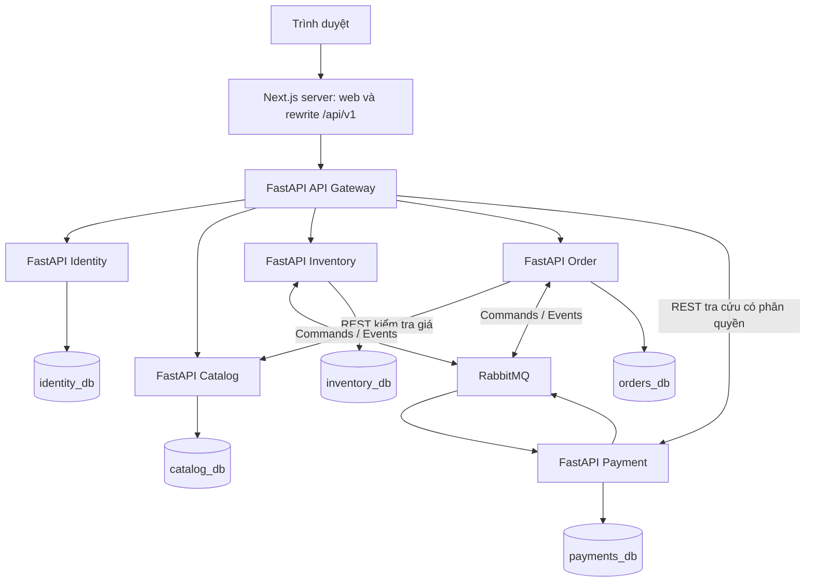
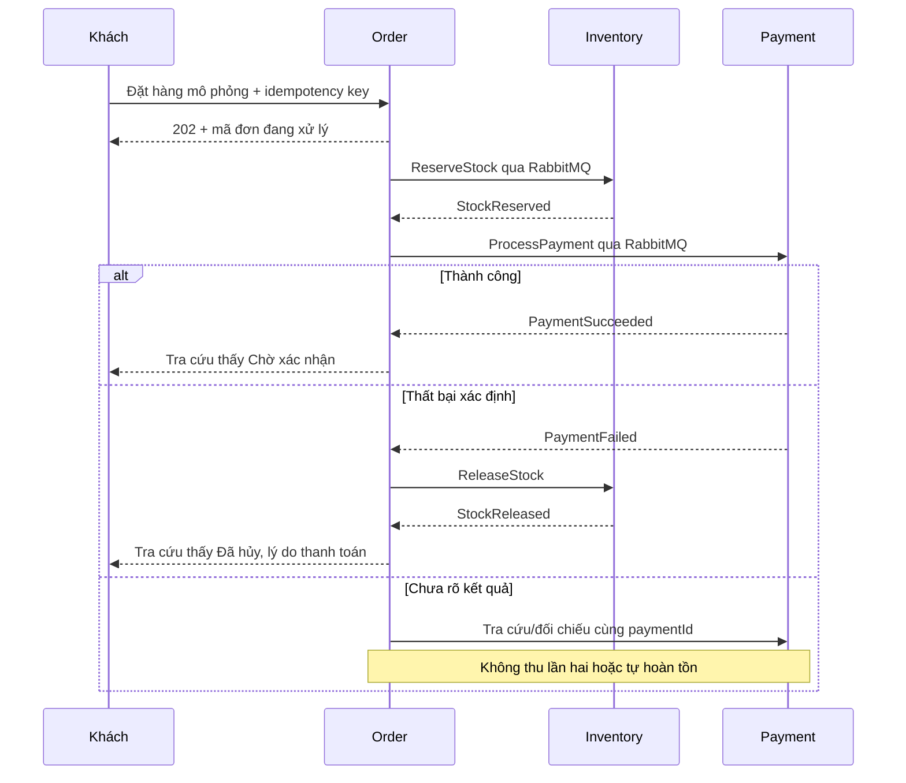
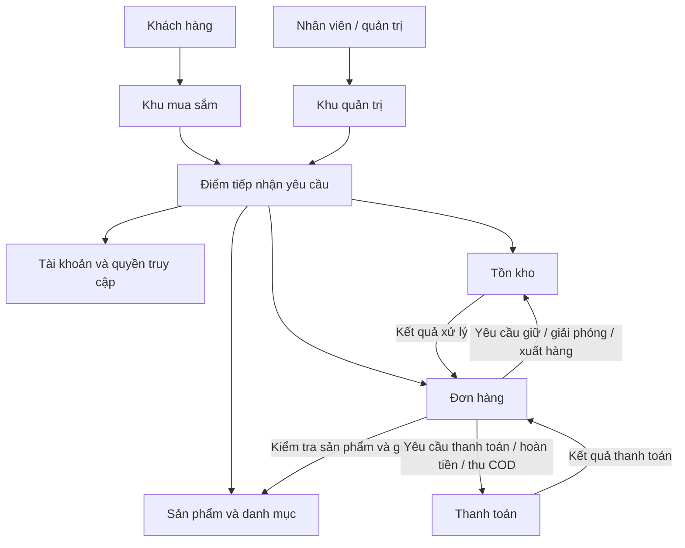

# Mô tả hệ thống và phạm vi MVP

Ngày lập: 24/10/2026  
Sản phẩm: Website thương mại điện tử cho một cửa hàng  
Nhóm: 5 thành viên — thời gian kế hoạch: 8 tuần  
Tài liệu liên quan: [Mô tả website](../product/MO-TA-WEBSITE.md)

Bộ tài liệu đi kèm: [hướng dẫn đọc](../../README.md), [đặc tả nghiệp vụ](../product/DAC-TA-NGHIEP-VU.md), [giao diện](THIET-KE-GIAO-DIEN.md), [workflow](THIET-KE-LUONG-XU-LY.md), [HTTP/OpenAPI](../contracts/HTTP-API.md), [message](../contracts/MESSAGES.md), [kế hoạch](../project/KE-HOACH-THUC-HIEN.md), [kiểm thử](../testing/KE-HOACH-KIEM-THU.md). Phần đặc tả mới bổ sung quote và chi tiết API quản trị; dùng hợp đồng trong `contracts/` khi triển khai, danh sách endpoint bên dưới là bản tổng quan.

## 1. Mục đích và trạng thái tài liệu

Tài liệu này chuyển mô tả website thành một thiết kế hệ thống ở mức khái niệm: hệ thống gồm những phần nào, ai chịu trách nhiệm cho dữ liệu nào, các phần phối hợp thế nào và MVP dừng ở đâu.

Bản cập nhật này bổ sung kiến trúc kỹ thuật cụ thể tại mục 1A: Next.js + TypeScript, FastAPI, PostgreSQL + SQLAlchemy/Alembic, RabbitMQ và Docker Compose. Next.js/TypeScript và FastAPI/Python đã được nhóm chọn; thư viện phụ trợ là đề xuất triển khai. Khi bắt đầu code, khóa phiên bản tương thích bằng lockfile và image tag cụ thể.

**Cập nhật 28/10/2026:** nhóm đã chọn FastAPI/Python cho backend, bao gồm gateway và năm service. SQLAlchemy, Alembic, aio-pika và thư viện phụ trợ dưới đây là đề xuất đi kèm để triển khai stack Python thống nhất.

**Đã chốt:** một cửa hàng duy nhất, nhóm 5 người, định hướng microservices. Không phải sàn cho nhiều người bán.

**Giả định còn cần chốt:** thực hiện trong 8 tuần; một kho, VND, một mức phí giao hàng; phụ kiện máy tính là ngành hàng minh họa. MVP giữ COD và bổ sung thanh toán mô phỏng qua Payment Service theo quyết định mới.

**Đã chốt bổ sung:** Payment Service mô phỏng thuộc MVP, cùng Identity, Catalog, Inventory và Order. Không tích hợp cổng thanh toán thật.

## 1A. Kiến trúc kỹ thuật và bộ công nghệ

### A. Bộ công nghệ đề xuất

| Lớp | Công nghệ | Vai trò | Ưu tiên |
| --- | --- | --- | --- |
| Ngôn ngữ | TypeScript (frontend), Python (backend) | Next.js và các service FastAPI | MVP |
| Frontend | Next.js, dựa trên React | Website khách hàng và khu quản trị; nhóm đã chọn | MVP |
| Điều hướng | Next.js App Router (đề xuất) | Page/layout theo thư mục, không cần React Router | MVP |
| Dữ liệu frontend | fetch và TanStack Query khi cần | Server fetch cho trang phù hợp; Client Components cho state/polling | MVP |
| Giao diện | Tailwind CSS | Responsive và trình bày thống nhất | MVP |
| Runtime backend | Python + Uvicorn | Chạy ứng dụng ASGI của gateway và service | MVP |
| Backend | FastAPI + Pydantic | API, validation và phân quyền; consumer riêng dùng aio-pika | MVP |
| Database | PostgreSQL | Lưu dữ liệu và transaction cục bộ | MVP |
| ORM/migration | SQLAlchemy async + asyncpg / Alembic | Model, transaction và migration riêng từng service | MVP |
| HTTP | REST/JSON | Giao tiếp frontend và truy vấn nội bộ | MVP |
| Message broker/client | RabbitMQ + aio-pika | Commands/events, ACK sau commit, publisher confirms | MVP |
| Xác thực | JWT + refresh token có quản lý phiên | Đăng nhập, danh tính, vai trò | MVP |
| Tài liệu API | OpenAPI/Swagger | Endpoint, request, response, lỗi | MVP |
| Đóng gói | Docker | Image riêng từng ứng dụng | MVP |
| Chạy hệ thống | Docker Compose | Container, network, volume và cấu hình | MVP |
| Public HTTP dev | Next.js rewrites; Nginx tùy nhu cầu | Next.js server phục vụ web; `/api/v1` chuyển tới gateway | MVP |
| Log | Python logging + structlog, JSON | Tra cứu theo service, requestId, orderId | MVP |
| Backend test | pytest + HTTPX + AnyIO | Test nghiệp vụ và HTTP integration | MVP |
| E2E | Playwright | Kiểm thử luồng khách và quản trị | MVP |
| CI | GitHub Actions | Typecheck, lint, test, build khi mở PR | MVP |
| Điều phối nâng cao | Kubernetes qua kind hoặc minikube | Replica, rolling update | Sau MVP, trừ yêu cầu môn học |
| Tracing | OpenTelemetry + Jaeger | Lần theo request qua nhiều service | Sau MVP |

Chưa cần Redis, Elasticsearch, Kafka, gRPC, service mesh hoặc Knative trong MVP. Không đưa thêm công nghệ nếu chưa có bài toán cụ thể.

### B. Danh sách service, database và cổng

| Ứng dụng | Công nghệ | Database | HTTP port nội bộ đề xuất | Trách nhiệm |
| --- | --- | --- | --- | --- |
| `web` | Next.js + TypeScript, Node server | Không | 3100 | Mua sắm, quản trị; tránh trùng gateway 3000 |
| `api-gateway` | FastAPI | Không | 3000 | Routing, xác thực yêu cầu ngoài, tổng hợp dữ liệu đọc |
| `identity-service` | FastAPI + SQLAlchemy | `identity_db` | 3001 | Tài khoản, vai trò, phiên đăng nhập |
| `catalog-service` | FastAPI + SQLAlchemy | `catalog_db` | 3002 | Sản phẩm, danh mục, giá, ảnh |
| `inventory-service` | FastAPI + SQLAlchemy | `inventory_db` | 3003 | Tồn, giữ, giải phóng, xuất hàng |
| `order-service` | FastAPI + SQLAlchemy | `orders_db` | 3004 | Đơn, snapshot, điều phối quy trình; bản sao trạng thái thanh toán |
| `payment-service` | FastAPI + SQLAlchemy | `payments_db` | 3005 | COD, thanh toán và hoàn tiền mô phỏng trong MVP |

**MVP: 5 service nghiệp vụ + 1 gateway + 1 frontend.** Payment sở hữu giao dịch và trạng thái thanh toán cho cả COD và phương thức mô phỏng. Không cần mỗi thành viên tương ứng đúng một service. PostgreSQL, RabbitMQ và Nginx là hạ tầng, không tính là service nghiệp vụ.

Các port trên là quy ước nội bộ. Triển khai chỉ public web qua HTTPS; database, broker và backend ở mạng nội bộ. Giao diện quản trị broker chỉ mở hạn chế cho người phát triển.

### C. Sơ đồ triển khai



**Đã chốt Supabase cho dev 28/10/2026:** nhóm phát triển hằng ngày trên cùng database Supabase `postgres`, với 5 schema: `commerce_identity`, `commerce_catalog`, `commerce_inventory`, `commerce_orders`, `commerce_payments`. Backend có thể chạy trên laptop mỗi thành viên, kết nối DB dev chung bằng role service riêng để đọc cùng dữ liệu. Mỗi service có runtime/migration role giới hạn schema mình. Test cần reset dùng PostgreSQL riêng cùng tên schema; DB local độc lập là tùy chọn, không bắt buộc cho dev. **Production chưa quyết định.** Tên *_db trong sơ đồ/bảng là miền dữ liệu logic, không phải 5 database vật lý. Xem [PHUONG-AN-SUPABASE.md](../infrastructure/PHUONG-AN-SUPABASE.md). Cấm FK/join/truy cập chéo service; tài nguyên thực tế chưa tạo/kiểm chứng.

### D. API HTTP dự kiến

Frontend gọi gateway qua `/api/v1`. Gateway không chứa logic giữ hàng hoặc điều phối đơn; service tương ứng chịu trách nhiệm nghiệp vụ.

| Nhóm | Route ví dụ | Service | Quyền |
| --- | --- | --- | --- |
| Tài khoản | `POST /auth/register`, `/auth/login`, `/auth/refresh`, `/auth/logout` | Identity | Theo thao tác/phiên |
| Hồ sơ | `GET /users/me` | Identity | Đăng nhập |
| Xem hàng | `GET /products`, `/products/:id`, `/categories` | Catalog | Công khai |
| Quản trị hàng | `POST /admin/products`, `PATCH /admin/products/:id` | Catalog | Quản trị |
| Danh mục | `POST /admin/categories`, `PATCH /admin/categories/:id` | Catalog | Quản trị |
| Tồn | `GET /admin/inventory`, `POST /admin/inventory/adjustments` | Inventory | Quản trị |
| Đặt hàng | `POST /orders` với `Idempotency-Key` | Order | Khách đăng nhập |
| Tra cứu đơn | `GET /orders`, `GET /orders/:id` | Order | Chủ đơn |
| Hủy đơn | `POST /orders/:id/cancel` | Order | Chủ đơn, đúng điều kiện |
| Xử lý đơn | `GET /admin/orders`, `POST /admin/orders/:id/confirm`, `/dispatch`, `/complete`, `/cancel` | Order | Quản trị |

Khi chưa xử lý xong, tạo đơn trả `202 Accepted` và `orderId`; frontend polling chi tiết đơn, dừng khi có kết quả cuối. MVP chưa cần WebSocket. Các lỗi có mã nghiệp vụ và thông báo rõ; cùng idempotency key với payload khác phải bị từ chối, không âm thầm dùng kết quả cũ.

Giữ hàng không phải endpoint công khai cho khách. Gateway có thể ghép sản phẩm với trạng thái tồn bằng truy vấn nội bộ theo lô; không gọi riêng một lần cho mỗi sản phẩm. Nếu không đọc được tồn, hiển thị chưa xác định thay vì tự coi còn hàng.

### E. Giao tiếp REST và RabbitMQ

**REST:** đăng nhập, đọc hàng, quản trị, tra cứu đơn; Order gọi Catalog để kiểm tra giá. Lời gọi có timeout, xác thực service và retry có kiểm soát; không retry ghi dữ liệu thiếu cơ chế chống lặp.

**RabbitMQ:** Order gửi command, Inventory thực hiện và trả event. Order lưu tiến trình và điều phối; không cần một Saga service riêng.

| Command từ Order | Bên xử lý | Event trả về |
| --- | --- | --- |
| `ReserveStock` | Inventory | `StockReserved` / `StockReservationFailed` |
| `ReleaseStock` | Inventory | `StockReleased` / `StockReleaseFailed` |
| `CommitStock` | Inventory | `StockCommitted` / `StockCommitFailed` |

Exchange `commerce.commands` định tuyến lệnh vào queue `inventory.commands`; exchange `commerce.events` định tuyến kết quả vào `order.events`. Nếu nhiều service đều cần một event, mỗi service nhận có queue riêng; một queue chia sẻ không phát bản sao cho tất cả consumer.

Message có `messageId`, `type`, `version`, `correlationId`, `causationId`, `occurredAt`, `payload`. Thao tác tồn có thêm `orderId`, `operationId`, danh sách mã hàng và số lượng.

Cơ chế bắt buộc:

- Durable queue, persistent message, publisher confirms và kiểm tra routing message.
- Manual acknowledgement sau khi transaction xử lý đã commit.
- Ghi nhận message đã xử lý cùng transaction nghiệp vụ; ràng buộc theo operationId tránh cùng thao tác mang messageId mới bị thực hiện lại.
- Order và Inventory ghi outbox cùng transaction thay đổi dữ liệu; worker gửi và retry. Publisher confirm chỉ xác nhận phía broker, không thay event kết quả nghiệp vụ.
- Retry giới hạn/backoff; lỗi kéo dài đưa dead-letter queue để kiểm tra, phát lại có kiểm soát.
- Job phát hiện tiến trình treo và đối chiếu kết quả. Không hủy chỉ vì timeout.

### F. Thiết kế database chi tiết cho MVP

| Database | Bảng chính đề xuất |
| --- | --- |
| `identity_db` | `users`, `refresh_sessions` |
| `catalog_db` | `products`, `categories`, `product_images` |
| `inventory_db` | `stock_items`, `reservations`, `reservation_items`, `inventory_operations`, `stock_movements`, `processed_messages`, `outbox_messages` |
| `orders_db` | `orders`, `order_items`, `order_status_history`, `order_workflows`, `idempotency_requests`, `order_action_requests`, `processed_messages`, `outbox_messages` |
| `payments_db` | `payment_attempts`, `refund_attempts`, `payment_status_history`, `demo_configuration`, `demo_configuration_history`, `processed_messages`, `outbox_messages` |

Mỗi service có SQLAlchemy models, Alembic migrations và credentials riêng; không chia sẻ ORM model hoặc SQLAlchemy session giữa các service. Không foreign key xuyên database.

Tiền VND lưu số nguyên đơn vị đồng với miền giá trị phù hợp; Order tính từ giá Catalog. Thời gian lưu UTC, giao diện hiển thị múi giờ Việt Nam. Đơn lưu snapshot tên, giá, địa chỉ và phí.

Giữ nhiều mặt hàng dùng một transaction Inventory, cập nhật có điều kiện/khóa hàng theo thứ tự mã hàng thống nhất và xử lý xung đột. Đọc tồn rồi cập nhật không có bảo vệ không đủ chống bán vượt tồn.

#### F.1. Quy ước chung và cách đọc

Thiết kế dưới đây là schema đề xuất để triển khai MVP, chưa phải migration đã chạy. Mỗi bảng được liệt kê đầy đủ field riêng; các field thời gian dùng chung được nêu rõ tại từng bảng.

- `PK`: khóa chính; `FK`: khóa ngoại trong cùng database; `UQ`: duy nhất; `NULL`: được phép để trống. Field không ghi NULL là bắt buộc.
- ID dùng `uuid`. ID tham chiếu sang service khác chỉ lưu giá trị, **không có FK xuyên database**.
- `timestamptz` lưu thời điểm; API trả ISO 8601, giao diện hiển thị múi giờ Việt Nam. `created_at` mặc định thời điểm tạo; `updated_at` được ứng dụng cập nhật khi thay đổi.
- Tiền dùng `bigint` đơn vị đồng, không âm; tiền tệ `varchar(3)` với CHECK bằng `VND` trong MVP. API serialize bigint thành chuỗi số thập phân để tránh mất độ chính xác ở JavaScript.
- Trạng thái dùng `varchar` kèm CHECK hoặc enum tương đương. Không cho giá trị ngoài danh sách. Chuyển trạng thái hợp lệ còn phải kiểm tra tại service, không chỉ CHECK giá trị.
- `jsonb` chỉ dùng cho payload/snapshot kỹ thuật có schema và version; không thay thế các field quan trọng như giá, lượng hoặc trạng thái.
- ID người thao tác tham chiếu Identity, không FK. Khi tác nhân là hệ thống, actor_id được NULL và actor_type là SYSTEM.
- Không xóa cứng đơn, thanh toán hoặc lịch sử kho trong MVP. FK lịch sử dùng RESTRICT; chính sách lưu trữ dữ liệu sau này phải được thiết kế riêng.
- `version integer DEFAULT 0` dùng khóa lạc quan: UPDATE theo id và version cũ, tăng version khi thành công. Không thay thế transaction/khóa khi cần cập nhật nhiều hàng.

**Quan hệ nội bộ:** Identity: users 1–N refresh_sessions; Catalog: categories 1–N products 1–N product_images; Inventory: reservations 1–N reservation_items N–1 stock_items; Order: orders 1–N order_items/history và 1–1 workflow; Payment: payment_attempts 1–0..1 refund_attempts trong MVP.

**Bảng bổ sung so với danh sách tóm tắt:** `inventory_operations` ghi kết quả command kho kể cả bị từ chối để retry an toàn; `payment_status_history` lưu lịch sử thanh toán/hoàn tiền. Hai bảng này thuộc MVP.

#### F.2. identity_db — users

Tài khoản khách và quản trị; chưa tách bảng role vì MVP chỉ có hai vai trò.

| Field | Kiểu / yêu cầu | Ý nghĩa |
| --- | --- | --- |
| `id` | uuid, PK | Mã người dùng. |
| `email` | varchar(254), UQ | Email được trim và chuẩn hóa chữ thường trước khi lưu. |
| `password_hash` | text | Chuỗi hash Argon2id có tham số; không lưu mật khẩu gốc. |
| `full_name` | varchar(150) | Tên hiển thị; khác tên người nhận snapshot trên đơn. |
| `role` | varchar(20) | CUSTOMER hoặc ADMIN. |
| `status` | varchar(20) | ACTIVE hoặc DISABLED. |
| `created_at` | timestamptz | Thời điểm tạo. |
| `updated_at` | timestamptz | Lần cập nhật gần nhất. |

Ràng buộc: email chuẩn hóa duy nhất; CHECK role/status. Tài khoản bị vô hiệu hóa không được cấp/refresh token mới; thu hồi phiên hiện có theo chính sách xác thực.

#### F.3. identity_db — refresh_sessions

Mỗi hàng đại diện một refresh token trong một chuỗi luân chuyển; không ghi đè token cũ khi rotate.

| Field | Kiểu / yêu cầu | Ý nghĩa |
| --- | --- | --- |
| `id` | uuid, PK | Mã refresh session/token record. |
| `user_id` | uuid, FK users.id | Chủ tài khoản. |
| `family_id` | uuid, index | Nhóm token của một phiên đăng nhập, dùng thu hồi cả chuỗi khi phát hiện tái sử dụng. |
| `token_hash` | text, UQ | Bản băm token ngẫu nhiên; không lưu token gốc. |
| `expires_at` | timestamptz | Hạn token. |
| `revoked_at` | timestamptz, NULL | Thời điểm logout/thu hồi/rotate. |
| `replaced_by_id` | uuid, NULL, FK refresh_sessions.id | Token record kế tiếp khi rotate. |
| `user_agent` | text, NULL | Thông tin trình duyệt để hỗ trợ quản lý phiên. |
| `created_at` | timestamptz | Thời điểm tạo. |

Index (user_id, revoked_at), expires_at. Rotate trong transaction: kiểm tra chưa thu hồi/chưa hết hạn, thu hồi record cũ và tạo record mới cùng family. Có lịch dọn record hết hạn theo thời hạn lưu đã thống nhất.

#### F.4. catalog_db — categories

Danh mục phẳng trong MVP, chưa có cây danh mục.

| Field | Kiểu / yêu cầu | Ý nghĩa |
| --- | --- | --- |
| `id` | uuid, PK | Mã danh mục. |
| `name` | varchar(100) | Tên danh mục. |
| `slug` | varchar(120), UQ | Định danh URL. |
| `description` | text, NULL | Mô tả danh mục. |
| `is_visible` | boolean DEFAULT true | Có xuất hiện trên điều hướng hay không. |
| `created_at` | timestamptz | Thời điểm tạo. |
| `updated_at` | timestamptz | Thời điểm sửa. |

Ẩn danh mục không tự ngừng bán sản phẩm. Không xóa danh mục còn được products tham chiếu.

#### F.5. catalog_db — products

Nguồn dữ liệu hiện tại của sản phẩm; không chứa tồn kho.

| Field | Kiểu / yêu cầu | Ý nghĩa |
| --- | --- | --- |
| `id` | uuid, PK | Mã sản phẩm dùng xuyên hệ thống. |
| `category_id` | uuid, FK categories.id | Danh mục hiện tại. |
| `sku` | varchar(64), UQ | Mã mặt hàng; mỗi màu/cấu hình là một SKU riêng trong MVP. |
| `slug` | varchar(180), UQ | Đường dẫn chi tiết. |
| `name` | varchar(200) | Tên sản phẩm. |
| `description` | text | Mô tả. |
| `specifications` | jsonb DEFAULT {} | Thông số trình bày dạng key/value được validate; không dùng để quản lý biến thể. |
| `price_amount` | bigint | Giá hiện tại theo đồng. |
| `currency` | varchar(3) DEFAULT VND | Tiền tệ. |
| `status` | varchar(20) | DRAFT, ACTIVE hoặc DISCONTINUED. |
| `version` | integer DEFAULT 0 | Phiên bản thông tin để phát hiện thay đổi. |
| `created_at` | timestamptz | Thời điểm tạo. |
| `updated_at` | timestamptz | Lần sửa cuối. |

CHECK price_amount >= 0; index (category_id, status), (status, price_amount). MVP tìm tên bằng truy vấn phù hợp dữ liệu nhỏ; index tìm kiếm chuyên dụng chỉ thêm sau đo đạc. Chỉ ACTIVE được đặt mới. Không xóa sản phẩm đã bán.

#### F.6. catalog_db — product_images

Metadata ảnh; file thật nằm trong volume của Catalog.

| Field | Kiểu / yêu cầu | Ý nghĩa |
| --- | --- | --- |
| `id` | uuid, PK | Mã ảnh. |
| `product_id` | uuid, FK products.id | Sản phẩm sở hữu ảnh. |
| `storage_key` | text, UQ | Đường dẫn tương đối nội bộ an toàn; không nhận nguyên đường dẫn tùy ý từ khách. |
| `mime_type` | varchar(50) | Loại ảnh sau kiểm tra. |
| `size_bytes` | bigint | Kích thước file. |
| `alt_text` | varchar(255), NULL | Mô tả thay thế. |
| `sort_order` | integer | Thứ tự ảnh; ảnh thứ tự nhỏ nhất là ảnh đại diện. |
| `created_at` | timestamptz | Thời điểm tải lên. |

CHECK size_bytes > 0, sort_order >= 0; UQ(product_id, sort_order). Không cần is_primary trùng chức năng. Backup cả file và metadata; upload DB/file lỗi phải có cleanup file mồ côi.

#### F.7. inventory_db — stock_items

Một hàng cho một sản phẩm tại kho duy nhất.

| Field | Kiểu / yêu cầu | Ý nghĩa |
| --- | --- | --- |
| `product_id` | uuid, PK, tham chiếu ngoài | Mã Catalog; không FK xuyên DB. |
| `on_hand_quantity` | integer DEFAULT 0 | Tồn thực tế. |
| `reserved_quantity` | integer DEFAULT 0 | Lượng đang giữ. |
| `low_stock_threshold` | integer DEFAULT 5 | Ngưỡng cảnh báo, quản trị có thể chỉnh. |
| `version` | integer DEFAULT 0 | Phát hiện ghi cạnh tranh. |
| `created_at` | timestamptz | Khởi tạo mặt hàng kho. |
| `updated_at` | timestamptz | Lần thay đổi cuối. |

CHECK on_hand_quantity >= 0, reserved_quantity >= 0, reserved_quantity <= on_hand_quantity, low_stock_threshold >= 0. available_quantity = on_hand_quantity - reserved_quantity, tính khi đọc, không lưu cột thứ ba. Khởi tạo tồn 0 khi quản trị thêm hàng vào kho sau khi xác minh Catalog; sản phẩm chưa có stock_item được coi chưa có hàng để bán.

#### F.8. inventory_db — reservations

Một reservation cho một đơn; không lưu đơn bị từ chối giữ hàng ở đây.

| Field | Kiểu / yêu cầu | Ý nghĩa |
| --- | --- | --- |
| `id` | uuid, PK | Mã reservation. |
| `order_id` | uuid, UQ, tham chiếu ngoài | Đơn sở hữu. |
| `status` | varchar(20) | RESERVED, RELEASED, COMMITTED. |
| `version` | integer DEFAULT 0 | Chặn hủy và xuất cùng reservation. |
| `created_at` | timestamptz | Thời điểm giữ. |
| `updated_at` | timestamptz | Lần cập nhật. |
| `released_at` | timestamptz, NULL | Thời điểm hoàn trả lượng giữ. |
| `committed_at` | timestamptz, NULL | Thời điểm xuất hàng. |

Không tự hết hạn reservation trong MVP. RELEASED và COMMITTED là trạng thái kết thúc, không chuyển qua lại. Không được có cả released_at và committed_at. Command bị từ chối được ghi inventory_operations.

#### F.9. inventory_db — reservation_items

Các mặt hàng được giữ cho reservation.

| Field | Kiểu / yêu cầu | Ý nghĩa |
| --- | --- | --- |
| `id` | uuid, PK | Mã dòng. |
| `reservation_id` | uuid, FK reservations.id | Reservation sở hữu. |
| `product_id` | uuid, FK stock_items.product_id | Mặt hàng kho. |
| `quantity` | integer | Lượng được giữ. |
| `created_at` | timestamptz | Thời điểm tạo. |

UQ(reservation_id, product_id), CHECK quantity > 0. Sau giữ thành công không sửa dòng; chỉ đổi trạng thái reservation và cập nhật counters trong transaction.

#### F.10. inventory_db — inventory_operations

Chống lặp theo thao tác nghiệp vụ, kể cả yêu cầu dùng messageId mới hoặc giữ hàng thất bại.

| Field | Kiểu / yêu cầu | Ý nghĩa |
| --- | --- | --- |
| `operation_id` | uuid, PK | Mã ổn định do Order hoặc API quản trị cấp. |
| `order_id` | uuid, NULL, tham chiếu ngoài | Đơn liên quan; NULL với nhập/điều chỉnh kho. |
| `operation_type` | varchar(20) | RESERVE, RELEASE, COMMIT, ADJUST. |
| `request_hash` | varchar(64) | SHA-256 payload chuẩn hóa để phát hiện dùng lại mã với dữ liệu khác. |
| `result_status` | varchar(20) | SUCCEEDED hoặc REJECTED. |
| `result_payload` | jsonb | Kết quả đã lưu để trả lại khi nhận lặp. |
| `error_code` | varchar(64), NULL | Lý do từ chối nghiệp vụ. |
| `created_at` | timestamptz | Thời điểm quyết định. |

Index order_id. Ghi trong cùng transaction với thay đổi kho và outbox kết quả. Hai command tranh cùng operation_id phải chỉ một bên thực thi. Lỗi kỹ thuật rollback để retry; REJECTED là kết quả nghiệp vụ xác định.

#### F.11. inventory_db — stock_movements

Nhật ký bất biến của mọi biến động thực tế hoặc lượng giữ.

| Field | Kiểu / yêu cầu | Ý nghĩa |
| --- | --- | --- |
| `id` | uuid, PK | Mã biến động. |
| `operation_id` | uuid, FK inventory_operations.operation_id | Thao tác gây biến động. |
| `product_id` | uuid, FK stock_items.product_id | Mặt hàng. |
| `reservation_id` | uuid, NULL, FK reservations.id | Reservation nếu có. |
| `movement_type` | varchar(20) | RECEIPT, ADJUSTMENT, RESERVE, RELEASE, COMMIT. |
| `on_hand_delta` | integer | Chênh lệch tồn thực tế, có thể âm. |
| `reserved_delta` | integer | Chênh lệch lượng giữ, có thể âm. |
| `on_hand_after` | integer | Tồn thực tế ngay sau thao tác. |
| `reserved_after` | integer | Lượng giữ ngay sau thao tác. |
| `reason` | text | Lý do nhập, điều chỉnh hoặc xử lý đơn. |
| `actor_type` | varchar(20) | USER hoặc SYSTEM. |
| `actor_id` | uuid, NULL, tham chiếu ngoài | Quản trị thao tác, nếu có. |
| `created_at` | timestamptz | Thời điểm ghi. |

UQ(operation_id, product_id), index (product_id, created_at). RESERVE: (0,+q); RELEASE: (0,-q); COMMIT: (-q,-q). RECEIPT/ADJUSTMENT thay on_hand. Counter, movement, operation và outbox phải commit cùng nhau.

#### F.12. orders_db — orders

Thông tin đơn, dữ liệu khách tại lúc đặt và trạng thái phản chiếu của Payment.

| Field | Kiểu / yêu cầu | Ý nghĩa |
| --- | --- | --- |
| `id` | uuid, PK | Mã nội bộ, tạo ngay khi nhận yêu cầu. |
| `order_number` | varchar(32), UQ | Mã đơn dễ đọc hiển thị cho khách. |
| `customer_id` | uuid, tham chiếu ngoài | Chủ đơn từ Identity. |
| `status` | varchar(30) | PROCESSING, AWAITING_CONFIRMATION, PREPARING, SHIPPING, COMPLETED, CANCELLING, CANCELLED, REJECTED. |
| `payment_method` | varchar(20) | COD hoặc SIMULATED. |
| `payment_id` | uuid, NULL, tham chiếu ngoài | Payment được liên kết sau khi khởi tạo. |
| `payment_status` | varchar(30), NULL | Bản sao trạng thái Payment; NULL trước khi có payment record. |
| `payment_version` | integer, NULL | Phiên bản Payment đã áp dụng, tránh ghi đè bởi event cũ. |
| `recipient_name` | varchar(150) | Tên người nhận snapshot. |
| `recipient_phone` | varchar(30) | Số liên hệ snapshot, lưu chuỗi. |
| `shipping_address` | text | Địa chỉ đầy đủ snapshot. |
| `customer_note` | text, NULL | Ghi chú khách. |
| `subtotal_amount` | bigint | Tổng quantity × unit_price_amount các dòng. |
| `shipping_fee_amount` | bigint | Phí ship chốt lúc đặt. |
| `total_amount` | bigint | subtotal_amount + shipping_fee_amount. |
| `currency` | varchar(3) DEFAULT VND | Tiền tệ. |
| `cancel_reason` | text, NULL | Lý do hủy. |
| `rejection_code` | varchar(64), NULL | Lý do từ chối yêu cầu như không đủ hàng. |
| `requires_attention` | boolean DEFAULT false | Cần quản trị kiểm tra; không tự đổi thành hoàn thành. |
| `exception_note` | text, NULL | Thông tin ngoại lệ giao hàng/quy trình. |
| `version` | integer DEFAULT 0 | Kiểm soát ghi đồng thời. |
| `created_at` | timestamptz | Thời điểm tạo. |
| `updated_at` | timestamptz | Lần thay đổi gần nhất. |
| `confirmed_at` | timestamptz, NULL | Cửa hàng xác nhận. |
| `dispatched_at` | timestamptz, NULL | Xuất hàng thành công. |
| `completed_at` | timestamptz, NULL | Hoàn tất giao và thu tiền. |
| `cancelled_at` | timestamptz, NULL | Hoàn tất bù trừ khi hủy. |

CHECK các amount >= 0 và total = subtotal + shipping_fee. Tổng các order_items được kiểm tra trong transaction ứng dụng, không CHECK xuyên bảng. Index (customer_id, created_at), (status, created_at). REJECTED dùng cho chưa tiếp nhận do thiếu hàng; CANCELLED cho đơn kết thúc hủy sau xử lý thanh toán/giữ hàng. Không xóa đơn để làm lại.

#### F.13. orders_db — order_items

Snapshot cố định của từng dòng mua.

| Field | Kiểu / yêu cầu | Ý nghĩa |
| --- | --- | --- |
| `id` | uuid, PK | Mã dòng. |
| `order_id` | uuid, FK orders.id | Đơn sở hữu. |
| `product_id` | uuid, tham chiếu ngoài | Mã Catalog để tham khảo/mua lại. |
| `product_sku` | varchar(64) | SKU lúc đặt. |
| `product_name` | varchar(200) | Tên lúc đặt. |
| `catalog_version` | integer | Phiên bản thông tin đã xác nhận. |
| `unit_price_amount` | bigint | Đơn giá snapshot. |
| `quantity` | integer | Số lượng. |
| `line_total_amount` | bigint | Đơn giá × số lượng. |
| `created_at` | timestamptz | Thời điểm tạo. |

UQ(order_id, product_id); CHECK quantity > 0, unit_price >= 0, line_total = unit_price × quantity. Không join Catalog để tính lại đơn cũ.

#### F.14. orders_db — order_status_history

Lịch sử chuyển trạng thái đơn, gồm thao tác người dùng và sự kiện hệ thống.

| Field | Kiểu / yêu cầu | Ý nghĩa |
| --- | --- | --- |
| `id` | uuid, PK | Mã lịch sử. |
| `order_id` | uuid, FK orders.id | Đơn. |
| `from_status` | varchar(30), NULL | NULL khi tạo lần đầu. |
| `to_status` | varchar(30) | Trạng thái mới. |
| `actor_type` | varchar(20) | CUSTOMER, ADMIN hoặc SYSTEM. |
| `actor_id` | uuid, NULL, tham chiếu ngoài | Người thao tác. |
| `reason` | text, NULL | Lý do chuyển/hủy. |
| `correlation_id` | uuid | Mã luồng xử lý. |
| `message_id` | uuid, NULL | Message gây thay đổi nếu có. |
| `created_at` | timestamptz | Thời điểm. |

Index (order_id, created_at). Append-only, ghi cùng transaction đổi orders.status.

#### F.15. orders_db — order_workflows

Một hàng điều phối tồn tại suốt vòng đời đơn, lưu tiến trình đủ để phục hồi; không tạo Saga service riêng.

| Field | Kiểu / yêu cầu | Ý nghĩa |
| --- | --- | --- |
| `order_id` | uuid, PK, FK orders.id | Đơn được điều phối. |
| `phase` | varchar(30) | CHECKOUT, IDLE, CANCELLATION, DISPATCH, COMPLETION. |
| `state` | varchar(20) | RUNNING, WAITING, DONE, NEEDS_ATTENTION. |
| `stock_step` | varchar(30) | NOT_REQUESTED, RESERVE_PENDING, RESERVED, RESERVE_FAILED, RELEASE_PENDING, RELEASED, COMMIT_PENDING, COMMITTED. |
| `payment_step` | varchar(30) | NOT_REQUESTED, INIT_PENDING, PENDING, COD_READY, PAID, FAILED, CANCEL_PENDING, CANCELLED, REFUND_PENDING, REFUNDED, COLLECT_PENDING. |
| `reserve_operation_id` | uuid, NULL | Mã ổn định cho giữ hàng. |
| `release_operation_id` | uuid, NULL | Mã ổn định cho giải phóng. |
| `commit_operation_id` | uuid, NULL | Mã ổn định cho xuất hàng. |
| `payment_operation_id` | uuid, NULL | Mã khởi tạo COD hoặc thanh toán. |
| `refund_operation_id` | uuid, NULL | Mã hoàn tiền. |
| `cancel_payment_operation_id` | uuid, NULL | Mã hủy COD. |
| `collection_operation_id` | uuid, NULL | Mã ghi nhận thu COD. |
| `correlation_id` | uuid | Mã luồng liên kết log/message. |
| `retry_count` | integer DEFAULT 0 | Số lần phục hồi bước hiện tại. |
| `next_retry_at` | timestamptz, NULL | Lần kiểm tra/thử lại tiếp theo. |
| `last_error_code` | varchar(64), NULL | Lỗi gần nhất. |
| `last_error_message` | text, NULL | Chi tiết đã lọc dữ liệu nhạy cảm. |
| `version` | integer DEFAULT 0 | Khóa lạc quan. |
| `created_at` | timestamptz | Thời điểm tạo. |
| `updated_at` | timestamptz | Lần cập nhật. |

Index (state, next_retry_at). Không sinh operationId mới khi retry. Hai nhánh hủy lưu stock_step/payment_step độc lập: chỉ nhánh chưa xong được thử lại. Khi DONE ở IDLE vẫn giữ row để xử lý các thao tác vòng đời tiếp theo. Job claim bằng transaction/khóa hoặc version để không phát lệnh trùng ngoài kiểm soát.

#### F.16. orders_db — idempotency_requests

Ghi nhận yêu cầu HTTP tạo đơn để việc bấm/gửi lại không tạo đơn mới.

| Field | Kiểu / yêu cầu | Ý nghĩa |
| --- | --- | --- |
| `id` | uuid, PK | Mã record. |
| `customer_id` | uuid, tham chiếu ngoài | Người gửi. |
| `scope` | varchar(100) | MVP: CREATE_ORDER; tránh trùng key khác loại thao tác. |
| `idempotency_key` | varchar(128) | Giá trị header do client tạo. |
| `request_hash` | varchar(64) | SHA-256 payload chuẩn hóa gồm giỏ, giá xác nhận, địa chỉ, phương thức. |
| `order_id` | uuid, FK orders.id | Đơn đã tạo. |
| `response_status` | integer | Mã HTTP đã trả, thường 202. |
| `response_body` | jsonb | Phản hồi ban đầu gồm orderId; trạng thái mới đọc tại API chi tiết. |
| `created_at` | timestamptz | Thời điểm tiếp nhận. |

UQ(customer_id, scope, idempotency_key). Tạo order, workflow và idempotency record trong một transaction sau validation; ghi cạnh tranh phải xử lý unique conflict và đọc lại record thắng. Cùng key khác hash trả 409. MVP giữ record cùng vòng đời đơn, chưa tự xóa TTL khiến key cũ tạo đơn mới.

#### F.17. payments_db — payment_attempts

Một record thanh toán trên một đơn trong MVP; Payment sở hữu dữ liệu gốc, Order chỉ giữ bản sao.

| Field | Kiểu / yêu cầu | Ý nghĩa |
| --- | --- | --- |
| `id` | uuid, PK | paymentId. |
| `order_id` | uuid, UQ, tham chiếu ngoài | Đơn thanh toán; UQ thể hiện một lần trên một đơn. |
| `customer_id` | uuid, tham chiếu ngoài | Chủ đơn từ command Order đã xác thực, để kiểm tra quyền đọc. |
| `operation_id` | uuid, UQ | Mã khởi tạo ổn định. |
| `request_hash` | varchar(64) | Phát hiện khởi tạo lại với tiền/phương thức khác. |
| `method` | varchar(20) | COD hoặc SIMULATED. |
| `amount` | bigint | Tổng phải trả từ snapshot Order. |
| `currency` | varchar(3) DEFAULT VND | Tiền tệ. |
| `status` | varchar(30) | PENDING, AWAITING_COLLECTION, SUCCEEDED, FAILED, REFUND_PENDING, REFUNDED, CANCELLED. |
| `simulation_scenario` | varchar(30), NULL | SUCCESS, FAILURE, DELAYED_SUCCESS, DELAYED_FAILURE; NULL cho COD, chỉ cấu hình demo có quyền. |
| `resolve_after` | timestamptz, NULL | Mốc worker quyết định kết quả mô phỏng chậm. |
| `failure_code` | varchar(64), NULL | Lý do thanh toán thất bại xác định. |
| `collection_operation_id` | uuid, NULL, UQ | Chống ghi nhận COD lần hai. |
| `cancel_operation_id` | uuid, NULL, UQ | Chống hủy nghĩa vụ COD lần hai. |
| `collected_by` | uuid, NULL, tham chiếu ngoài | Quản trị xác nhận thu COD qua Order. |
| `version` | integer DEFAULT 0 | Tăng khi thay trạng thái; gửi kèm event. |
| `created_at` | timestamptz | Khởi tạo. |
| `updated_at` | timestamptz | Lần thay đổi. |
| `succeeded_at` | timestamptz, NULL | Thanh toán/thu COD thành công. |
| `failed_at` | timestamptz, NULL | Kết quả thất bại xác định. |
| `cancelled_at` | timestamptz, NULL | Hủy COD chưa thu. |

CHECK amount >= 0 và method/status phù hợp. Index (status, resolve_after), (customer_id, created_at). Mô phỏng thu tiền đúng một lần, dù worker restart. Không retry FAILED trên cùng đơn. Trạng thái và event outbox được ghi chung transaction. Tiền thật và provider transaction ID chưa thuộc schema MVP.

#### F.18. payments_db — refund_attempts

Một khoản hoàn toàn bộ cho một payment mô phỏng đã thành công; retry sử dụng cùng hàng.

| Field | Kiểu / yêu cầu | Ý nghĩa |
| --- | --- | --- |
| `id` | uuid, PK | Mã hoàn tiền. |
| `payment_id` | uuid, UQ, FK payment_attempts.id | Khoản gốc; một refund trong MVP. |
| `operation_id` | uuid, UQ | Mã hoàn ổn định từ Order. |
| `request_hash` | varchar(64) | Hash yêu cầu hoàn, phát hiện dùng lại sai dữ liệu. |
| `amount` | bigint | Số tiền hoàn toàn bộ. |
| `currency` | varchar(3) DEFAULT VND | Tiền tệ. |
| `status` | varchar(20) | PENDING, SUCCEEDED, NEEDS_ATTENTION. |
| `reason` | text | Lý do hủy/hoàn. |
| `simulation_scenario` | varchar(30) | SUCCESS, DELAYED_SUCCESS hoặc FAIL_UNTIL_RETRY; cấu hình demo có quyền. |
| `retry_count` | integer DEFAULT 0 | Số lần thử. |
| `next_retry_at` | timestamptz, NULL | Lịch thử/kiểm tra. |
| `last_error_code` | varchar(64), NULL | Lỗi gần nhất. |
| `version` | integer DEFAULT 0 | Kiểm soát worker ghi cạnh tranh. |
| `created_at` | timestamptz | Thời điểm yêu cầu. |
| `updated_at` | timestamptz | Lần cập nhật. |
| `completed_at` | timestamptz, NULL | Hoàn thành mô phỏng. |

Amount/currency phải bằng payment gốc, kiểm tra trong transaction khóa payment. Chỉ SIMULATED đã SUCCEEDED được hoàn, không hoàn COD chưa thu. Refund lỗi giữ payment REFUND_PENDING và order CANCELLING. Thành công cập nhật refund, payment REFUNDED, history và outbox cùng transaction; không tạo refund mới cho retry.

#### F.19. payments_db — payment_status_history

Nhật ký thay đổi payment/refund để giải thích giao dịch.

| Field | Kiểu / yêu cầu | Ý nghĩa |
| --- | --- | --- |
| `id` | uuid, PK | Mã lịch sử. |
| `payment_id` | uuid, FK payment_attempts.id | Payment liên quan. |
| `refund_id` | uuid, NULL, FK refund_attempts.id | Nếu là thay đổi refund. |
| `entity_type` | varchar(20) | PAYMENT hoặc REFUND. |
| `from_status` | varchar(30), NULL | Trạng thái cũ. |
| `to_status` | varchar(30) | Trạng thái mới. |
| `operation_id` | uuid | Mã thao tác. |
| `message_id` | uuid, NULL | Message gây thay đổi. |
| `actor_type` | varchar(20) | SYSTEM hoặc ADMIN. |
| `actor_id` | uuid, NULL, tham chiếu ngoài | Người thao tác nếu có. |
| `reason` | text, NULL | Lý do/kết quả. |
| `created_at` | timestamptz | Thời điểm. |

Index (payment_id, created_at). REFUND yêu cầu refund_id và kiểm tra refund thuộc payment; PAYMENT có refund_id NULL. Chỉ ghi append, cùng transaction trạng thái.

#### F.20. processed_messages — có riêng trong Inventory, Order và Payment

Bảng inbox chống xử lý lặp ở cấp vận chuyển; ba database chứa ba bản độc lập, không dùng chung DB.

| Field | Kiểu / yêu cầu | Ý nghĩa |
| --- | --- | --- |
| `consumer_name` | varchar(100), một phần PK | Tên handler/consumer logic ổn định. |
| `message_id` | uuid, một phần PK | ID message nhận. |
| `message_type` | varchar(100) | Loại command/event. |
| `message_version` | integer | Phiên bản schema. |
| `payload_hash` | varchar(64) | Phát hiện cùng messageId nhưng payload bị đổi. |
| `correlation_id` | uuid | Mã luồng. |
| `processed_at` | timestamptz | Thời điểm xử lý đã commit. |

PK(consumer_name, message_id). Insert inbox, đổi nghiệp vụ, tạo outbox chung transaction. ACK sau commit. Lỗi kỹ thuật rollback inbox để nhận lại. Chưa xóa inbox tự động trong MVP; về sau retention phải dài hơn cửa sổ có thể replay. Inbox không thay thế UQ operationId của nghiệp vụ.

#### F.21. outbox_messages — có riêng trong Inventory, Order và Payment

Công việc gửi message đã được lưu cùng transaction nghiệp vụ.

| Field | Kiểu / yêu cầu | Ý nghĩa |
| --- | --- | --- |
| `id` | uuid, PK | Dùng làm messageId khi publish, giữ nguyên qua retry. |
| `message_type` | varchar(100) | Ví dụ ReserveStock, PaymentSucceeded. |
| `message_version` | integer DEFAULT 1 | Phiên bản hợp đồng. |
| `aggregate_type` | varchar(50) | ORDER, RESERVATION, PAYMENT hoặc REFUND. |
| `aggregate_id` | uuid | Đối tượng nghiệp vụ trong DB phát. |
| `aggregate_version` | integer, NULL | Phiên bản trạng thái nếu có, hỗ trợ chống event cũ. |
| `exchange_name` | varchar(100) | commerce.commands hoặc commerce.events. |
| `routing_key` | varchar(150) | Định tuyến đến queue đúng. |
| `correlation_id` | uuid | Mã luồng. |
| `causation_id` | uuid, NULL | Message/yêu cầu gây ra message này. |
| `payload` | jsonb | Payload có schema; không chứa mật khẩu/token. |
| `status` | varchar(20) DEFAULT PENDING | PENDING, PROCESSING, PUBLISHED, NEEDS_ATTENTION. |
| `attempt_count` | integer DEFAULT 0 | Số lần gửi. |
| `next_attempt_at` | timestamptz | Thời điểm đủ điều kiện gửi. |
| `locked_by` | varchar(100), NULL | Worker đang claim. |
| `locked_until` | timestamptz, NULL | Hạn lease, cho khôi phục khi worker chết. |
| `last_error` | text, NULL | Lỗi gửi gần nhất. |
| `created_at` | timestamptz | Thời điểm tạo, dùng làm occurredAt. |
| `published_at` | timestamptz, NULL | Đã nhận confirm và xác nhận routing phù hợp. |

Index (status, next_attempt_at), locked_until và (aggregate_type, aggregate_id). Worker claim trong transaction ngắn, gửi ngoài transaction DB, đánh dấu kết quả nếu còn giữ lease. Lease hết hạn được claim lại. Crash sau publish trước ghi PUBLISHED có thể gửi trùng: consumer phải idempotent. Không tuyên bố outbox bảo đảm exactly-once.

#### F.22. Transaction và ranh giới dữ liệu cần giữ

| Thao tác | Các bảng phải cập nhật cùng transaction cục bộ |
| --- | --- |
| Tạo đơn | orders + order_items + order_workflows + idempotency_requests + history + outbox |
| Giữ/giải phóng/xuất kho | stock_items + reservations/items + inventory_operations + stock_movements + inbox + outbox |
| Xử lý event ở Order | inbox + orders + workflow + history + outbox bước tiếp theo |
| Ghi nhận thanh toán | payment_attempts + history + inbox nếu từ message + outbox |
| Hoàn tiền thành công | refund_attempts + payment_attempts + history + outbox, thêm inbox nếu xử lý trực tiếp message |

Không dùng transaction chung bao trùm 5 miền dữ liệu/service, dù cùng một database vật lý. Mỗi service chỉ ghi schema của mình; workflow lưu tiến độ và thực hiện bù trừ/đối chiếu khi một bước chưa rõ kết quả.

**Ví dụ:** một đơn mua 2 chuột giá 200.000 đồng và phí ship 30.000 đồng có subtotal 400.000, total 430.000. Order lưu giá snapshot; Inventory giữ 2 đơn vị; Payment ghi amount 430.000. Nếu thanh toán mô phỏng thất bại, giữ lịch sử FAILED, giải phóng 2 đơn vị và kết thúc hủy; không xóa dấu vết payment. Nếu thanh toán thành công rồi hủy trước giao, refund là 430.000 đồng, bao gồm phí ship chưa thực hiện.

**Những bảng không có trong MVP:** carts/cart_items phía server, addresses, roles/permissions động, product_variants, vouchers, shipments tích hợp, notifications, seller_accounts. Chỉ bổ sung khi feature tương ứng được duyệt.

#### F.23. Bổ sung để khớp hợp đồng HTTP và màn hình demo

Các bảng sau là đề xuất chi tiết khi viết bộ hợp đồng 0.1. Cần đưa vào migration khi triển khai các API tương ứng.

**orders_db — order_action_requests:** lưu việc hủy/xác nhận/bàn giao/hoàn thành/ghi ngoại lệ đã tiếp nhận qua HTTP, để replay không phụ thuộc RAM hoặc chỉ dựa vào trạng thái hiện tại.

| Field | Kiểu / yêu cầu | Ý nghĩa |
| --- | --- | --- |
| `id` | uuid, PK | Mã yêu cầu hành động |
| `order_id` | uuid, FK orders.id | Đơn được tác động |
| `actor_id` | uuid, tham chiếu ngoài | Người gửi đã xác thực |
| `action` | varchar(30) | CANCEL, CONFIRM, DISPATCH, COMPLETE, RECORD_EXCEPTION |
| `idempotency_key` | varchar(128) | Key HTTP |
| `request_hash` | varchar(64) | Hash payload chuẩn hóa |
| `response_status` | integer | Mã HTTP tiếp nhận |
| `response_body` | jsonb | Kết quả tiếp nhận cũ; trạng thái hiện tại đọc qua GET |
| `created_at` | timestamptz | Thời điểm nhận |

UQ(actor_id, order_id, action, idempotency_key). Insert cùng transaction đổi trạng thái/workflow/history và tạo outbox nếu có. Trùng key khác hash trả 409. Không ghi thành công trước khi transaction commit. Validation/state conflict trước tiếp nhận chưa chiếm key.

**payments_db — demo_configuration:** cấu hình duy nhất của môi trường demo, không chứa kết quả giao dịch cụ thể.

| Field | Kiểu / yêu cầu | Ý nghĩa |
| --- | --- | --- |
| `id` | integer, PK, CHECK = 1 | Một cấu hình hiện hành |
| `payment_scenario` | varchar(30) | SUCCESS, FAILURE, DELAYED_SUCCESS, DELAYED_FAILURE |
| `refund_scenario` | varchar(30) | SUCCESS, DELAYED_SUCCESS, FAIL_UNTIL_RETRY |
| `delay_seconds` | integer, CHECK 0..300 | Độ trễ mô phỏng |
| `version` | integer | Tăng khi thay đổi |
| `updated_by` | uuid, NULL khi seed, tham chiếu ngoài | ADMIN thay đổi; hệ thống để NULL lúc khởi tạo |
| `updated_at` | timestamptz | Thời điểm cập nhật |

Payment/refund chụp scenario lúc tạo, thay đổi config chỉ tác động record mới. FAIL_UNTIL_RETRY nghĩa là lần đầu hoàn tiền báo lỗi, lần thử kế tiếp cùng refundId có thể hoàn tất; không cần đổi config để sửa giao dịch cũ. Production tắt hoàn toàn route demo. Khởi tạo config qua seed với actor hệ thống; updated_by có thể NULL duy nhất trong lần seed trước thao tác quản trị đầu tiên.

**payments_db — demo_configuration_history:** lưu thay đổi cấu hình để biết vì sao demo có kết quả khác nhau.

| Field | Kiểu / yêu cầu | Ý nghĩa |
| --- | --- | --- |
| `id` | uuid, PK | Mã lịch sử |
| `configuration_id` | integer, FK demo_configuration.id | Cấu hình |
| `version` | integer | Phiên bản mới |
| `snapshot` | jsonb | Ba giá trị scenario/delay mới, schema cố định |
| `actor_id` | uuid, NULL, tham chiếu ngoài | ADMIN hoặc NULL khi seed hệ thống |
| `created_at` | timestamptz | Thời điểm |

UQ(configuration_id, version). Cập nhật configuration và history cùng transaction. Không ghi token vào snapshot.

Khởi tạo stock_item dùng product_id duy nhất, tồn 0: gửi lại sản phẩm đã khởi tạo trả record hiện tại nếu cấu hình khớp, không reset tồn. Adjustment sử dụng inventory_operations.operation_id được ánh xạ ổn định từ actor + scope + Idempotency-Key; request_hash phải gồm delta/lý do/version. Không đổi UUID ngẫu nhiên mỗi lần retry. Cơ chế ánh xạ này cần kiểm tra collision/unique và test replay khi triển khai.

### G. Xác thực, ảnh và cấu hình

- Băm mật khẩu bằng Argon2id; không log mật khẩu/token.
- Access token ngắn hạn; refresh token luân chuyển, phía server lưu bản băm và có thể thu hồi phiên.
- Refresh token dùng cookie HttpOnly, Secure trên HTTPS, SameSite phù hợp; kiểm tra Origin/chống CSRF cho endpoint dùng cookie. Access token giữ trong bộ nhớ frontend. Logout thu hồi refresh session; access token đã cấp còn hiệu lực đến hết hạn nếu chưa có thu hồi bổ sung.
- Service kiểm tra quyền tài nguyên; không tin header userId do client tự gửi. Gateway xác thực không thay thế kiểm tra chủ đơn tại Order.
- Catalog nhận upload ảnh của quản trị, giới hạn định dạng/dung lượng, chỉ chấp nhận ảnh raster được kiểm tra. File nằm trong volume, metadata nằm trong DB; Catalog phục vụ endpoint đọc ảnh. Backup gồm cả ảnh. Object storage để sau MVP.
- Repo chỉ lưu `.env.example`; secrets dùng cấu hình riêng, không commit mật khẩu hoặc khóa thật.

### H. Repository, triển khai và CI

```text
single-store-ecommerce/
├── apps/
│   ├── web/
│   ├── api-gateway/
│   ├── identity-service/
│   ├── catalog-service/
│   ├── inventory-service/
│   ├── order-service/
│   └── payment-service/
├── packages/contracts/   # API/event schema, không ORM model
├── infra/
│   ├── compose.yaml
│   ├── nginx/
│   └── postgres-init/
├── tests/e2e/
├── docs/
└── .github/workflows/ci.yml
```

Mỗi service có Dockerfile, migration và test riêng. Worker outbox có thể chạy trong service ở MVP; khi tăng replica cần cơ chế claim công việc an toàn.

Dev hằng ngày: thành viên chạy frontend/backend của mình trực tiếp hoặc bằng Docker, dùng Supabase dev chung; không cần PostgreSQL local cho luồng này. Luồng checkout đầy đủ dùng broker dev chung và địa chỉ HTTP của các service có thể truy cập từ các máy/host dev. Thống nhất ai chạy worker từng service để không có nhiều phiên bản code tranh cùng việc. DB test và broker test tách riêng khi reset/fault test. Có healthcheck và kết nối lại dependency. PostgreSQL/broker local độc lập chỉ là cấu hình tùy chọn cho test/offline. File ảnh dùng Catalog dev chung, không tự đồng bộ qua DB Supabase.

Production chưa được bàn hoặc chốt môi trường triển khai. Khi cần demo, nhóm sẽ quyết định cách chạy bộ ứng dụng; host dev chung là lựa chọn bổ sung, không điều kiện để dùng Supabase dev. CI chạy typecheck, lint, test, build; integration test dùng DB/broker test riêng. Cấu hình dev không được coi là thiết kế production.

### I. Payment Service trong MVP

#### Quy ước triển khai FastAPI/Python

- Mỗi backend có `pyproject.toml`, dependency lock, package Python, Pydantic schemas, SQLAlchemy models, Alembic migrations và test riêng. Node.js dùng build/chạy Next.js server; các service nghiệp vụ tiếp tục chạy Python/FastAPI.
- HTTP server dùng Uvicorn; FastAPI router/dependency kiểm tra đầu vào và quyền. Gateway dùng HTTPX AsyncClient để chuyển tiếp/tổng hợp, có timeout/pool giới hạn, chỉ cho route upstream khai báo sẵn; không nhận URL tùy ý từ client và không tự viết lại quy tắc nghiệp vụ.
- SQLAlchemy async với asyncpg; một AsyncSession cho mỗi request hoặc lần xử lý message/job. Không chia sẻ session giữa các coroutine, không giữ transaction DB mở trong lúc chờ HTTP/broker. Dữ liệu nghiệp vụ và inbox/outbox vẫn commit cùng transaction cục bộ.
- RabbitMQ dùng aio-pika cho consumer/publisher. Worker outbox, consumer và job đối chiếu là công việc bền vững dựa trên DB/broker; không dùng FastAPI BackgroundTasks làm hàng đợi cho thao tác tiền/tồn. Nếu chạy cùng tiến trình MVP, quản lý khởi động/tắt qua lifespan và phục hồi; nhiều process/replica vẫn cần claim/lease và idempotency.
- Pydantic schemas tách khỏi ORM models; dùng validation ràng buộc và serializer rõ ràng. Python int giữ được bigint nhưng response tiền vẫn phải là chuỗi VND theo hợp đồng, timestamp UTC. Field Python có thể snake_case, JSON public giữ camelCase bằng alias, không đổi contract chỉ vì đổi framework.
- FastAPI mặc định có thể trả 422 cho validation; hợp đồng dự án dùng 400 với Error envelope. Cần exception handler chuyển RequestValidationError và chuẩn hóa lỗi HTTP/domain, giữ header xác thực cần thiết. Schema OpenAPI sinh từ từng service phải được so sánh với hợp đồng public, không tự thay file đã thống nhất bằng schema mặc định.
- Không chạy Alembic đồng thời ở mọi worker khi startup. Có bước migration riêng trước khi nhận traffic; review autogenerate, bổ sung CHECK/index/constraint cần thiết bằng migration. Không dùng create_all thay migration môi trường chung.
- Backend test dùng pytest + HTTPX, AnyIO cho async; chủ động quản lý lifespan khi test cần startup resources. Integration kho/tiền dùng PostgreSQL và RabbitMQ thật, không thay SQLite để kết luận về transaction/cạnh tranh.
- CI backend đề xuất Ruff (lint/format), mypy (typecheck), pytest và build image; frontend giữ TypeScript toolchain và Playwright E2E. Khóa phiên bản khi tạo skeleton, chưa ghi lệnh cài/chạy chưa kiểm chứng.

```text
apps/order-service/
├── pyproject.toml
├── alembic.ini
├── migrations/
├── app/
│   ├── main.py          # FastAPI app và lifespan
│   ├── api/             # routers và dependencies
│   ├── schemas/         # Pydantic request/response/message
│   ├── models/          # SQLAlchemy models của orders_db
│   ├── services/        # use case và workflow
│   ├── repositories/    # truy cập DB trong transaction
│   ├── messaging/       # aio-pika consumers/publishers
│   └── workers/         # outbox và phục hồi
└── tests/
```

API, enum, database fields, command/event và trách nhiệm 5 service vẫn theo hợp đồng đã viết. Đây là cập nhật thiết kế, chưa tạo skeleton hoặc cài package.

MVP bao gồm `payment-service`, `payments_db`, queue `payment.commands`, command `ProcessPayment`/`RefundPayment` và event kết quả. Order vẫn điều phối.

Luồng: tạo đơn → giữ hàng → thanh toán mô phỏng → tiếp nhận đơn khi thành công. Thất bại xác định thì giải phóng hàng và kết thúc đơn; timeout phải tra cứu trạng thái, không tự kết luận thất bại. Hàng đã thanh toán vẫn giữ đến khi xuất kho, không coi thanh toán là giao hàng.

Hủy đơn đã thanh toán phải xử lý hoàn tiền mô phỏng và giải phóng hàng, lưu tiến trình từng bước. Kết quả mô phỏng thành công/thất bại/chậm phải lựa chọn được trong môi trường demo để test lặp lại, không random.

COD và thanh toán mô phỏng đều thuộc MVP. Payment là nguồn dữ liệu chính về thanh toán; Order lưu trạng thái phản chiếu từ event để hiển thị, không tự sửa giao dịch Payment.

#### Hợp đồng và trạng thái Payment bắt buộc trong MVP

| Command | Kết quả từ Payment | Quy tắc |
| --- | --- | --- |
| `InitializeCodPayment` | `PaymentInitialized` | Tạo nghĩa vụ chờ thu COD một lần |
| `ProcessPayment` | `PaymentSucceeded` / `PaymentFailed` | Mô phỏng thanh toán; chậm vẫn giữ PENDING đến khi có kết quả xác định |
| `RecordCodCollection` | `CodCollected` | Chỉ từ Order sau thao tác quản trị hợp lệ |
| `CancelCodPayment` | `CodPaymentCancelled` | Chỉ hủy COD chưa thu |
| `RefundPayment` | `PaymentRefunded` / `PaymentRefundFailed` | Hoàn mô phỏng toàn bộ khoản đã thành công, tối đa một lần |

Command đến `payment.commands`; event qua `commerce.events` đến `order.events`. Outbox, publisher confirms, inbox/chống lặp và dead-letter queue áp dụng cho Payment như Order/Inventory. Lỗi nghiệp vụ do command không hợp lệ phải trả kết quả từ chối có mã lý do, không báo thành công giả hoặc retry vô hạn.

Payment lưu `paymentId`, `orderId`, `operationId`, phương thức, số tiền, tiền tệ, trạng thái, thời điểm và mã lỗi. Số tiền lấy từ snapshot Order qua command nội bộ, không lấy trực tiếp từ client. OrderId/operationId có ràng buộc duy nhất phù hợp; cùng operationId nhưng số tiền khác bị từ chối.

MVP một lần thanh toán trên một đơn. Gửi lại cùng yêu cầu trả kết quả cũ. Nếu thất bại, đợi hủy đơn và giải phóng hàng rồi khách tạo đơn mới; chưa hỗ trợ nhiều lần thử thanh toán trên cùng đơn.

Trạng thái thanh toán: `PENDING`, `AWAITING_COLLECTION`, `SUCCEEDED`, `FAILED`, `REFUND_PENDING`, `REFUNDED`, `CANCELLED`. Lỗi hoàn tiền giữ `REFUND_PENDING` kèm lỗi/cờ cần xử lý để tiếp tục, không làm đơn hiển thị đã hủy. Không chuyển khoản đã thành công về thất bại vì event cũ.

Gateway chuyển `GET /api/v1/payments/:paymentId` đến Payment; Payment kiểm tra chủ đơn bằng thông tin chủ sở hữu đáng tin cậy đã lưu từ Order. Endpoint nội bộ `GET /internal/payments/by-order/:orderId` phục vụ Order đối chiếu khi mất/chậm event, có xác thực service. Giao diện thường đọc trạng thái phản chiếu trong chi tiết đơn. Không mở API để khách tự xác nhận đã thanh toán.

Cấu hình mô phỏng thành công/thất bại/chậm và lỗi hoàn tiền chỉ do quản trị môi trường demo điều khiển. Trường hợp chậm được giải quyết sau độ trễ cấu hình hoặc thao tác quản trị có nhật ký; job đối chiếu phát hiện các trường hợp quá lâu. Không tự giải phóng reservation khi kết quả thanh toán chưa rõ.

Khách chưa được hủy khi thanh toán vẫn PENDING trong MVP. Nếu event thành công đến muộn, kiểm tra workflow trước khi chuyển trạng thái; nếu quy trình đã đi vào bù trừ, xử lý hoàn tiền theo tiến trình, không hồi sinh đơn đã kết thúc.



### J. Phân công đề xuất

| Người | Sở hữu chính | Phối hợp |
| --- | --- | --- |
| 1 | Identity, gateway, tích hợp | Compose/CI, review quyền |
| 2 | Catalog và Payment mô phỏng | Người 5 hỗ trợ UI quản trị; người 1 review Payment |
| 3 | Inventory | Test tranh chấp, cùng Order xử lý bù |
| 4 | Order, workflow | Outbox, chống lặp, khôi phục |
| 5 | Frontend mua sắm, tích hợp UI | E2E cùng chủ service |

Mỗi người viết migration, Dockerfile và test của mình. Không dồn toàn bộ hạ tầng và kiểm thử cho người frontend.

### K. Tài liệu chính thức tham khảo

- [FastAPI](https://fastapi.tiangolo.com/): API, validation và OpenAPI.
- [SQLAlchemy asyncio](https://docs.sqlalchemy.org/en/20/orm/extensions/asyncio.html): async engine/session.
- [Alembic](https://alembic.sqlalchemy.org/en/latest/tutorial.html): migration database.
- [aio-pika](https://docs.aio-pika.com/): RabbitMQ client và publisher confirms.
- [FastAPI testing](https://fastapi.tiangolo.com/tutorial/testing/): kiểm thử với pytest.
- [Docker Compose application model](https://docs.docker.com/compose/intro/compose-application-model/): khai báo các container, mạng và volume.

## 2. Mục tiêu hệ thống

- Hoàn thành luồng khách tìm hàng → đặt hàng → cửa hàng xử lý → giao thành công.
- Có ranh giới trách nhiệm rõ giữa tài khoản, sản phẩm, tồn kho và đơn hàng.
- Không tạo đơn trùng ngoài ý muốn, bán vượt tồn hoặc hoàn tồn nhiều lần.
- Theo dõi được trạng thái khi một bước xử lý chậm hoặc thất bại.
- Giữ lịch sử đơn và thao tác quản trị để tra cứu.
- Cho phép phát triển từng thành phần mà không phải truy cập trực tiếp dữ liệu nội bộ của thành phần khác.

MVP ưu tiên một luồng hoàn chỉnh có xử lý lỗi. Số lượng service không phải tiêu chí thay thế cho tính đúng đắn của nghiệp vụ.

## 3. Bức tranh tổng thể



Sơ đồ này thể hiện quan hệ nghiệp vụ; sơ đồ kỹ thuật và giao thức nằm ở mục 1A. Khu mua sắm và khu quản trị nằm trong cùng frontend nhưng phải tách quyền truy cập.

Điểm tiếp nhận yêu cầu chuyển yêu cầu đến đúng thành phần. Nó không quyết định đơn có được hủy hay tồn kho có đủ hay không; các quyết định thuộc thành phần nghiệp vụ tương ứng.

## 4. Thành phần hệ thống và quyền sở hữu dữ liệu

### 4.1. Tài khoản và quyền truy cập — Identity

**Trách nhiệm:** đăng ký, đăng nhập, đăng xuất; quản lý danh tính và vai trò.

**Dữ liệu sở hữu:** tài khoản, thông tin đăng nhập, trạng thái tài khoản, vai trò.

**Giới hạn MVP:** khách tự đăng ký; tài khoản quản trị được cấp sẵn; chưa xây màn hình quản lý nhân sự hoặc phân quyền chi tiết. Dùng hai vai trò khách hàng và quản trị cửa hàng.

Identity cung cấp danh tính người gọi. Order vẫn phải kiểm tra người đó có sở hữu đơn đang truy cập hay không. Catalog và Inventory kiểm tra quyền quản trị trước khi chấp nhận thay đổi.

### 4.2. Sản phẩm và danh mục — Catalog

**Trách nhiệm:** thông tin sản phẩm, phân loại, hình ảnh, giá hiện tại và trạng thái đang bán/ngừng bán.

**Dữ liệu sở hữu:** mã mặt hàng, tên, mô tả, thông số, giá, danh mục, tham chiếu hình ảnh và trạng thái bán.

**Không sở hữu:** số lượng còn trong kho, lượng đang giữ, giá lịch sử của đơn đã đặt.

MVP mỗi cấu hình bán là một mặt hàng riêng. Không có hệ thống chọn nhiều biến thể màu/kích thước trên cùng sản phẩm.

### 4.3. Tồn kho — Inventory

**Trách nhiệm:** nhập và điều chỉnh tồn, giữ hàng cho đơn, giải phóng hàng khi hủy, ghi nhận xuất hàng khi bàn giao giao hàng.

**Dữ liệu sở hữu:** tồn thực tế, lượng giữ theo từng đơn, lịch sử nhập/điều chỉnh/xuất hàng và kết quả yêu cầu đã xử lý.

Quy ước:

- Có thể bán = tồn thực tế − đang giữ.
- Giữ hàng: tăng đang giữ, chưa giảm tồn thực tế.
- Hủy trước khi giao: giảm đang giữ, tồn thực tế giữ nguyên.
- Bàn giao giao hàng: giảm cả tồn thực tế và đang giữ cùng lượng.

Ví dụ: tồn 10, giữ 3 thì có thể bán 7. Khi xuất 3 sản phẩm đã giữ, tồn còn 7, giữ về 0, có thể bán vẫn là 7.

Mỗi yêu cầu giữ cho đơn nhiều mặt hàng phải thành công toàn bộ hoặc thất bại toàn bộ. Không tự giữ một phần rồi báo đơn đã thành công.

### 4.4. Đơn hàng — Order

**Trách nhiệm:** tiếp nhận đặt hàng, tính tổng tiền từ dữ liệu đáng tin cậy, điều phối giữ hàng, quản lý trạng thái, hủy và lịch sử xử lý.

**Dữ liệu sở hữu:** đơn, các dòng hàng, người mua, thông tin người nhận, snapshot giá và tên hàng, phí giao hàng, trạng thái, lịch sử, tiến trình xử lý và mã chống tạo trùng.

Order lưu bản sao trạng thái thanh toán từ Payment để tra cứu. Payment sở hữu lần thanh toán, thu COD và hoàn tiền; Order không trực tiếp ghi payments_db.

Order không tự sửa số lượng tồn. Mọi thay đổi tồn phải do Inventory thực hiện và trả kết quả.

### 4.5. Giỏ hàng và giao diện

Giỏ hàng MVP thuộc trải nghiệm mua sắm, chưa tách thành service riêng. Giỏ được giữ trên cùng trình duyệt và tồn tại qua thao tác đăng nhập; chưa đồng bộ nhiều thiết bị. Không lưu thông tin thanh toán nhạy cảm trong giỏ.

Giỏ chứa mã mặt hàng và số lượng mong muốn. Giá hiển thị chỉ là tham khảo đến khi kiểm tra đặt hàng; giỏ không có quyền quyết định giá bán hoặc giữ tồn.

### 4.6. Payment trong MVP và Notification sau MVP

MVP gồm **năm service nghiệp vụ**. Payment dùng FastAPI + SQLAlchemy, sở hữu payments_db, có consumer RabbitMQ và worker outbox.

- **Payment:** bắt buộc trong MVP; tạo lần thanh toán, mô phỏng kết quả, ghi nhận thu COD, hoàn tiền mô phỏng và truy vấn kết quả.
- **Notification:** cân nhắc tách khi gửi email hoặc thông báo tự động cần lịch sử gửi, thử lại và nhiều kênh.

Không có tiền thật hoặc dữ liệu thẻ thật. Cơ chế hoàn tiền mô phỏng trước khi giao thuộc MVP; đổi trả sau khi nhận vẫn ngoài phạm vi.

## 5. Nguyên tắc trao đổi giữa các thành phần

1. Mỗi thành phần quản lý dữ liệu thuộc trách nhiệm của mình. Thành phần khác không đọc/ghi trực tiếp kho dữ liệu nội bộ đó.
2. Có thể trao đổi mã tham chiếu như mã người dùng, mã sản phẩm, mã đơn; không dùng quan hệ dữ liệu xuyên service để thay thế giao tiếp nghiệp vụ.
3. Dữ liệu lịch sử cần được chụp lại tại thời điểm giao dịch. Đổi tên hoặc giá sản phẩm không làm thay đổi đơn cũ.
4. Mọi yêu cầu thay đổi quan trọng có mã định danh để nhận biết lần gửi lặp.
5. Chậm phản hồi không đồng nghĩa thất bại. Phải có khả năng tra cứu kết quả hoặc tiếp tục bước còn dở.
6. Một trạng thái kết thúc chỉ được công bố khi các điều kiện nghiệp vụ liên quan đã đạt.

Ví dụ hợp đồng nghiệp vụ, chưa phải tên API cuối cùng:

| Yêu cầu | Bên xử lý | Kết quả cần có |
| --- | --- | --- |
| Kiểm tra sản phẩm và giá | Catalog | Đang bán hay không, giá được dùng để xác nhận |
| Giữ hàng cho đơn | Inventory | Đã giữ toàn bộ hoặc từ chối kèm mặt hàng thiếu |
| Giải phóng hàng của đơn | Inventory | Đã giải phóng hoặc đã xử lý yêu cầu trước đó |
| Xuất hàng đã giữ | Inventory | Đã xuất hoặc lý do chưa thể xuất |
| Tra cứu đơn của khách | Order | Thông tin đơn sau khi kiểm tra quyền sở hữu |

Nếu dùng xử lý bất đồng bộ, cần lưu bền vững công việc phải gửi và kết quả đã nhận. Việc lưu thay đổi nghiệp vụ cùng công việc chờ gửi được thiết kế theo outbox; xử lý lặp an toàn được thiết kế cùng với cập nhật nghiệp vụ. Cơ chế này thuộc độ đúng đắn của luồng đã chọn, không phải tính năng trang trí sau MVP.

## 6. Luồng nghiệp vụ chính

### 6.1. Tìm và xem sản phẩm

Khách tìm theo tên, lọc danh mục/khoảng giá và xem chi tiết. Thông tin sản phẩm đến từ Catalog; khả năng bán đến từ Inventory.

Tình trạng còn hàng khi xem có thể thay đổi trước khi đặt. Quyết định giữ hàng tại thời điểm đặt mới là căn cứ tiếp nhận đơn.

### 6.2. Đặt hàng COD hoặc thanh toán mô phỏng

1. Khách đăng nhập và gửi giỏ, thông tin nhận hàng, lựa chọn COD hoặc mô phỏng cùng mã yêu cầu.
2. Order kiểm tra đầu vào và xem yêu cầu này đã được tiếp nhận chưa.
3. Kiểm tra sản phẩm, giá và trạng thái bán với Catalog. Nếu giá khác giá khách đã xác nhận, yêu cầu khách xác nhận lại.
4. Lưu yêu cầu đơn đang xử lý và snapshot thông tin đã thống nhất. Giá được chốt ở bước xác nhận này; thay đổi giá sau đó áp dụng cho lượt mua mới.
5. Yêu cầu Inventory giữ đủ các mặt hàng.
6. Nếu giữ đủ, Order yêu cầu Payment tạo lần thanh toán. Với COD, Payment ghi nhận chờ thu và trả PaymentInitialized; với mô phỏng, chờ PaymentSucceeded. Chỉ sau kết quả phù hợp mới chuyển Chờ xác nhận. PaymentFailed dẫn đến giải phóng hàng rồi kết thúc đơn Đã hủy với lý do thanh toán thất bại.
7. Nếu không đủ, kết thúc yêu cầu với lý do; không có mặt hàng nào bị giữ cho yêu cầu đó.
8. Nếu chưa rõ kết quả, duy trì Đang xử lý, tra cứu/tiếp tục thay vì tạo đơn mới hoặc tự kết luận hết hàng.

Đơn đang xử lý phải có thể tra cứu để khách không mất dấu yêu cầu. Khi nhận kết quả thành công, giao diện xóa các mặt hàng đã mua khỏi giỏ.

### 6.3. Xác nhận và chuẩn bị

Nhân viên xem đơn Chờ xác nhận, kiểm tra thông tin rồi chuyển Đang chuẩn bị. Không giữ hàng lần hai. Ghi lại người thao tác và thời điểm.

### 6.4. Hủy trước khi giao

1. Order kiểm tra người gọi và trạng thái hiện tại.
2. Đánh dấu đang xử lý hủy, ngăn đồng thời chuyển sang giao hàng.
3. Yêu cầu Inventory giải phóng lượng giữ.
4. Đồng thời yêu cầu Payment hủy nghĩa vụ COD chưa thu hoặc hoàn tiền mô phỏng nếu đã thanh toán. Chỉ công bố Đã hủy khi cả giải phóng hàng và xử lý thanh toán hoàn tất; nếu một nhánh lỗi, lưu bước đã xong và chỉ thử lại nhánh còn thiếu.
5. Nếu chưa nhận được kết quả, tiếp tục tra cứu/thử lại cùng yêu cầu; chưa tuyên bố hủy hoàn tất.

Khách chỉ hủy khi Chờ xác nhận. Quản trị có thể hủy khi Chờ xác nhận hoặc Đang chuẩn bị, bắt buộc ghi lý do.

### 6.5. Bàn giao giao hàng

Nhân viên yêu cầu bàn giao đơn Đang chuẩn bị. Order yêu cầu Inventory xuất đúng lượng đã giữ. Sau khi xác nhận xuất thành công, đơn chuyển Đang giao. Yêu cầu lặp không xuất thêm lần nữa.

### 6.6. Hoàn thành và ghi nhận thu tiền

Nhân viên xác nhận đã giao. Với COD, Order gửi RecordCodCollection đến Payment từ thao tác quản trị có kiểm tra quyền; chỉ chuyển Hoàn thành sau CodCollected. Với mô phỏng đã thanh toán, xác nhận giao chuyển Hoàn thành mà không thu lần nữa.

Đơn đang giao nhưng chưa có kết quả không được tự đánh dấu hoàn thành. Giao thất bại, hàng quay về kho và đối soát thiếu tiền là quy trình mở rộng; MVP chỉ đánh dấu cần xử lý ngoại lệ, ghi chú và giữ trạng thái trung thực. Không tự hoàn tồn khi hàng chưa thực sự quay về.

## 7. Trạng thái và tính nhất quán

### 7.1. Trạng thái nghiệp vụ hiển thị

| Trạng thái | Điều kiện |
| --- | --- |
| Chờ xác nhận | Đã giữ đủ hàng; Payment đã tạo COD hoặc xác nhận thanh toán mô phỏng thành công |
| Đang chuẩn bị | Cửa hàng đã xác nhận, hàng vẫn đang giữ |
| Đang giao | Đã xuất hàng để bàn giao giao hàng |
| Hoàn thành | Đã giao thành công và Payment xác nhận đã thanh toán |
| Đã hủy | Đã giải phóng lượng giữ và hủy/hoàn thanh toán phù hợp |

### 7.2. Tiến trình xử lý trung gian

Hệ thống còn cần theo dõi đang tạo đơn, đang hủy, đang bàn giao, bị từ chối và cần xử lý ngoại lệ. Đây là tiến trình để phục hồi công việc, không được bỏ qua chỉ vì giao diện chính có năm trạng thái.

Tiến trình lưu bước đang làm, mã yêu cầu, thời điểm và kết quả liên quan. Restart một thành phần không được làm mất công việc đang dở. Người dùng thấy thông báo dễ hiểu như “Đang xử lý yêu cầu hủy”.

Không cho sự kiện hoặc phản hồi đến muộn làm chuyển ngược đơn đã kết thúc. Các thao tác cạnh tranh như hủy và xác nhận phải có một kết quả hợp lệ duy nhất theo trạng thái hiện tại.

## 8. Giới hạn MVP cụ thể

MVP là bộ chức năng tối thiểu hoàn chỉnh để khách mua được và cửa hàng xử lý được đơn; không chỉ là các màn hình độc lập.

| Phạm vi | Có trong MVP | Giới hạn |
| --- | --- | --- |
| Mô hình bán | Một cửa hàng | Không shop bên thứ ba |
| Tài khoản | Đăng ký, đăng nhập, đăng xuất | Khách và quản trị; chưa đăng nhập mạng xã hội |
| Sản phẩm | Tên, giá, ảnh, mô tả, thông số, danh mục | Mỗi mặt hàng một cấu hình; chưa biến thể phức tạp |
| Tìm kiếm | Theo tên, danh mục, khoảng giá | Chưa tìm kiếm ngữ nghĩa hoặc gợi ý cá nhân |
| Giỏ hàng | Thêm, sửa lượng, xóa; giữ qua đăng nhập | Cùng trình duyệt, không giữ tồn, chưa đồng bộ thiết bị |
| Đặt hàng | Nhiều mặt hàng trong một đơn | Nhận đủ toàn bộ; chưa giao/nhận một phần |
| Thanh toán | Payment Service: COD, mô phỏng thành công/thất bại/chậm, hoàn tiền khi hủy trước giao | Không cổng thật; không thu thẻ thật |
| Giao hàng | Phí cố định, cập nhật thủ công | Không kết nối vận chuyển hoặc tracking trực tiếp |
| Hủy | Trước khi giao; hoàn tiền mô phỏng nếu đã thanh toán | Chưa đổi trả/hoàn tiền thật sau nhận |
| Tồn kho | Một kho, nhập/điều chỉnh/giữ/xuất | Chưa mua hàng nhà cung cấp, nhiều kho, dự báo |
| Quản trị | Sản phẩm, danh mục, tồn, đơn, tổng quan đơn giản | Chưa quản lý nhân sự và phân quyền theo từng thao tác |
| Thông báo | Phản hồi trên web, tra cứu trạng thái | Chưa email, SMS, push |
| Báo cáo | Đếm đơn theo trạng thái, cảnh báo sắp hết | Chưa lợi nhuận hoặc kế toán |
| Ngôn ngữ/tiền | Tiếng Việt, VND | Chưa đa ngôn ngữ/đa tiền tệ |

Các màn hình bắt buộc được liệt kê trong tài liệu mô tả website. Thông tin nhận hàng nhập lúc đặt; chưa có sổ địa chỉ. Chưa sửa đơn đã tạo: khách hủy và đặt lại khi đủ điều kiện.

Không đưa thêm tính năng mới vào MVP sau khi khóa phạm vi trừ khi thay thế một hạng mục tương đương và cập nhật tiêu chí nghiệm thu.

## 9. Yêu cầu chất lượng trong MVP

- **Đúng dữ liệu:** không vượt tồn, không tạo đơn ngoài ý muốn, không thu/xuất/hoàn tồn lặp.
- **Quyền truy cập:** khách chỉ thấy đơn của mình; thay đổi quản trị có kiểm tra quyền và lịch sử.
- **Khôi phục:** thao tác dở có thể tiếp tục hoặc được phát hiện để xử lý; không mất dấu đơn.
- **Trải nghiệm:** dùng được trên điện thoại và máy tính; có trạng thái tải, trống, lỗi và chưa xác định kết quả.
- **Tra cứu:** tìm được luồng xử lý theo mã đơn hoặc mã yêu cầu.
- **Dữ liệu bền vững:** khởi động lại ứng dụng không mất đơn, tồn và lịch sử đã ghi nhận.
- **Vận hành demo:** có dữ liệu mẫu, hướng dẫn chạy, cách sao lưu/khôi phục và kịch bản kiểm thử.

Chưa cam kết số người dùng đồng thời hoặc thời gian phản hồi cụ thể khi chưa có môi trường và phép đo. Nhóm cần chọn quy mô kiểm thử thực tế, ghi cấu hình và kết quả thay vì tự nhận hệ thống chịu tải lớn.

## 10. Điều kiện nghiệm thu MVP

| Mã | Kịch bản | Kết quả mong đợi |
| --- | --- | --- |
| MVP-01 | Đặt nhiều mặt hàng COD | Một đơn đúng giá, lượng, phí và người nhận; giữ đủ hàng |
| MVP-02 | Nhân viên xử lý đến hoàn thành | Trạng thái hợp lệ, tồn chỉ xuất một lần, thu tiền được ghi nhận |
| MVP-03 | Khách hủy khi chờ xác nhận | Hủy hoàn tất sau giải phóng hàng; có lịch sử |
| MVP-04 | Hai khách mua mặt hàng chỉ còn một đơn vị | Chỉ một yêu cầu giữ thành công |
| MVP-05 | Một trong nhiều mặt hàng thiếu tồn | Không tiếp nhận một phần và không giữ sót mặt hàng khác |
| MVP-06 | Gửi lại cùng yêu cầu tạo đơn | Trả cùng kết quả, không tạo đơn mới |
| MVP-07 | Gửi lặp thao tác hủy hoặc xuất | Không tăng/giảm tồn thêm |
| MVP-08 | Giá đổi sau khi thêm giỏ | Yêu cầu xác nhận lại; giá đơn đã tiếp nhận giữ nguyên |
| MVP-09 | Khách truy cập đơn người khác | Bị từ chối, không lộ dữ liệu |
| MVP-10 | Gián đoạn sau giữ hàng nhưng trước phản hồi | Tra cứu/khôi phục được, không giữ lần hai hoặc mất dấu đơn |
| MVP-11 | Hủy và xác nhận/bàn giao cạnh tranh | Chỉ chuyển trạng thái hợp lệ, đơn và tồn không mâu thuẫn |
| MVP-12 | Restart giữa một quy trình | Công việc đã lưu được tiếp tục hoặc hiện rõ cần xử lý |
| MVP-13 | Sản phẩm ngừng bán | Không tạo đơn mới với sản phẩm đó; lịch sử đơn vẫn xem được |
| MVP-14 | Đơn giao chưa thành công | Không báo hoàn thành hoặc tự hoàn tồn sai thực tế |
| MVP-15 | Thanh toán mô phỏng thành công | Một lần thanh toán, đơn chờ xác nhận, hàng vẫn giữ |
| MVP-16 | Thanh toán thất bại | Giải phóng đủ hàng rồi hủy; không phát sinh khoản thành công |
| MVP-17 | Timeout hoặc restart Payment sau khi lưu kết quả | Khôi phục/đối chiếu cùng paymentId; không thu hoặc giải phóng hàng lần hai |
| MVP-18 | Hủy đơn đã thanh toán | Hoàn mô phỏng và giải phóng đủ hàng trước khi kết thúc hủy |
| MVP-19 | Hoàn tiền lỗi hoặc event hoàn tiền trùng | Giữ đang xử lý, thử lại an toàn; chỉ hoàn một lần |
| MVP-20 | Thu COD gửi lặp | Payment ghi nhận một lần; Order chỉ hoàn thành sau xác nhận |
| MVP-21 | Event cũ đến sau kết quả mới | Không đảo trạng thái, hồi sinh đơn hoặc ghi thu/hoàn thêm |

MVP hoàn thành khi các luồng trên hoạt động qua giao diện hoặc có bằng chứng kiểm thử phù hợp. Việc từng service khởi chạy riêng chưa đủ để nghiệm thu.

## 11. Feature mở rộng sau MVP

Chỉ chọn phần mở rộng sau khi MVP đạt nghiệm thu. Danh sách dưới đây là hướng phát triển, không phải cam kết làm hết trong 8 tuần.

### 11.1. Nhóm A — Hoàn thiện trải nghiệm mua sắm

| Feature | Giá trị | Điều kiện/phạm vi bổ sung |
| --- | --- | --- |
| Sổ địa chỉ | Khách không nhập lại mỗi lần mua | Địa chỉ mặc định; đơn vẫn lưu snapshot riêng |
| Khôi phục mật khẩu, xác minh email | Khách tự quản lý tài khoản | Liên kết có thời hạn, giới hạn thử và luồng gửi email |
| Thông báo email | Khách biết đơn được tiếp nhận/giao/hủy | Gửi lại khi lỗi, chống gửi trùng, lịch sử gửi |
| Giỏ hàng nhiều thiết bị | Tiếp tục mua trên thiết bị khác | Quy tắc gộp giỏ trước/sau đăng nhập |
| Mua lại từ đơn cũ | Giảm thao tác cho khách quay lại | Kiểm tra giá, trạng thái bán và tồn hiện tại |
| Danh sách yêu thích | Lưu sản phẩm muốn mua sau | Không giữ giá hoặc tồn |

### 11.2. Nhóm B — Mở rộng bán hàng và vận hành

| Feature | Giá trị | Điều kiện/phạm vi bổ sung |
| --- | --- | --- |
| Biến thể sản phẩm | Chọn màu, kích thước, cấu hình | Mã hàng, giá và tồn riêng theo biến thể |
| Voucher và khuyến mãi | Hỗ trợ chiến dịch bán | Hạn dùng, giới hạn lượt, điều kiện áp dụng, quy tắc khi hủy |
| Đánh giá sau mua | Tăng thông tin tham khảo | Xác minh mua hàng, kiểm duyệt và chống đánh giá lặp |
| Phân quyền nhân viên | Phân chia công việc thực tế | Quyền theo thao tác và lịch sử thay đổi quyền |
| Giao thất bại và nhận hàng trả về | Khép kín vận hành giao hàng | Lý do thất bại, kiểm nhận thực tế, quyết định nhập lại kho |
| Tự hết hạn đơn chờ | Giảm giữ hàng kéo dài | Thời hạn rõ; xử lý cạnh tranh với xác nhận và thanh toán |
| Báo cáo bán hàng | Hỗ trợ quyết định kinh doanh | Chốt định nghĩa doanh thu, đơn hoàn thành, hủy và hoàn tiền |

### 11.3. Nhóm C — Thanh toán và giao nhận

| Feature | Giá trị | Điều kiện/phạm vi bổ sung |
| --- | --- | --- |
| Thanh toán trực tuyến thật | Khách thanh toán ngay | Xác minh kết quả, đối soát, xử lý trùng, hoàn tiền và quản lý thông tin nhạy cảm |
| Tích hợp vận chuyển | Tạo vận đơn và nhận cập nhật | Mapping trạng thái, phí, hủy vận đơn, phản hồi trùng hoặc đến muộn |
| Đổi trả và hoàn tiền | Hỗ trợ sau bán | Điều kiện trả, kiểm hàng, nhập kho phù hợp, hoàn tiền và tranh chấp |

Khi nâng cấp sang cổng thanh toán thật, mở rộng từ workflow Order–Inventory–Payment đã có trong MVP, bổ sung xác minh kết quả và đối soát với nhà cung cấp. Không mặc định timeout là thất bại hoặc hoàn tồn khi tiền có thể đã thu.

### 11.4. Nhóm D — Quy mô và tối ưu

- Nhiều kho và phân bổ hàng theo nơi giao.
- Tìm kiếm nâng cao, đề xuất sản phẩm và cá nhân hóa.
- Tối ưu tốc độ theo số liệu thực tế; đo trước và sau thay đổi.
- Mở rộng triển khai và giám sát khi quy mô thực sự cần.

Chuyển sang sàn nhiều người bán là thay đổi mô hình sản phẩm lớn, không phải một feature nhỏ sau MVP. Cần đề án riêng về gian hàng, quyền sở hữu sản phẩm, chia đơn, hoa hồng và đối soát.

## 12. Thứ tự triển khai đề xuất trong 8 tuần

| Tuần | Kết quả sản phẩm/hệ thống |
| --- | --- |
| 1 | Chốt giả định, phạm vi, màn hình, ownership dữ liệu và trạng thái; thử luồng phối hợp nhỏ |
| 2 | Tạo đơn → giữ hàng → Payment mô phỏng thành công; giỏ và màn hình đặt tối thiểu |
| 3 | Thanh toán thất bại/chậm, hủy và hoàn tiền mô phỏng; outbox, chống lặp; hoàn thiện tài khoản và danh mục |
| 4 | Hai luồng COD và mô phỏng hoàn chỉnh qua giao diện, thu COD và xuất kho |
| 5 | Test tồn đồng thời, payment/refund trùng, timeout, event đến muộn, restart Payment và Order |
| 6 | Hoàn thiện quyền, trải nghiệm, lịch sử và môi trường demo; đánh giá nghiệm thu MVP |
| 7 | Sửa các điểm chưa đạt; chỉ chọn một mở rộng nhỏ nếu MVP đã ổn |
| 8 | Đóng băng tính năng, kiểm thử cuối, hoàn thiện tài liệu và diễn tập demo |

Không dành tuần cuối để ghép các phần lần đầu. Không coi các feature mở rộng là phần bắt buộc bù vào khi MVP chưa hoàn thành.

## 13. Các quyết định cần khóa trước khi triển khai

- Ngành hàng và tên cửa hàng.
- Payment đã được chốt trong MVP: thống nhất cấu hình các kịch bản mô phỏng và thời gian chờ cảnh báo.
- Năm service nghiệp vụ đã chốt; kiểm tra thêm yêu cầu triển khai của môn học.
- Phí giao hàng và phạm vi địa chỉ nhận hàng.
- Gộp quyền quản trị trong MVP hay cần tách nhân viên/chủ cửa hàng.
- Chính sách giữ hàng lâu, hủy và xử lý giao thất bại trong bản demo.
- Quy mô dữ liệu mẫu và các tình huống phải trình diễn.

Sau khi khóa các điểm trên, hai tài liệu sản phẩm và hệ thống cần được cập nhật cùng nhau. Bất kỳ thay đổi nào về thanh toán, hủy, tồn hoặc giao hàng phải phản ánh cả trải nghiệm người dùng lẫn quy trình xử lý bên trong.
