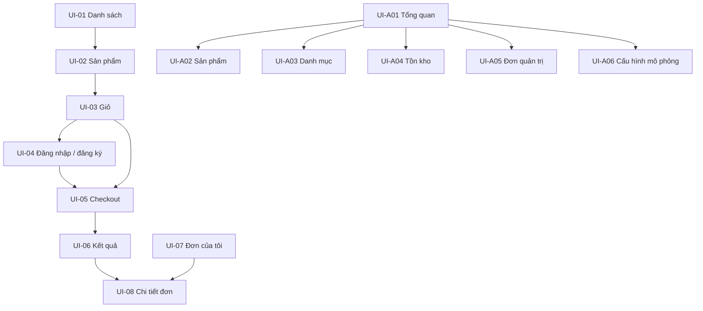

# Thiết kế giao diện và điều hướng

Wireframe nội dung phiên bản 0.1; chưa phải bản thiết kế đồ họa hoặc website đã xây. Tham chiếu [use case](../product/DAC-TA-NGHIEP-VU.md), [API](../contracts/HTTP-API.md).

## 1. Sơ đồ trang



Layout khách: header logo/tìm kiếm/tài khoản/giỏ, vùng nội dung và footer liên hệ/chính sách. Layout quản trị: menu bên trái trên desktop, menu thu gọn trên mobile, khu nội dung và tên người đăng nhập.

## 2. Màn hình khách

| Mã / đường dẫn | Nội dung và thao tác | Quy tắc / API |
| --- | --- | --- |
| UI-01 `/` | Tìm tên, danh mục, khoảng giá, sort; thẻ ảnh/tên/giá/còn hàng; phân trang | UC-CAT-01; GET products/categories; giữ filter trên URL |
| UI-02 `/products/:id` | Gallery, tên, mô tả, thông số, giá, số lượng, thêm giỏ | Hết hàng khóa thêm; tồn chưa rõ giải thích; không hiện số tồn nội bộ |
| UI-03 `/cart` | Dòng hàng, tăng/giảm, xóa, tiền dự kiến, tiếp tục mua/checkout | UC-CART-01; giỏ rỗng không checkout; giá chỉ tham khảo |
| UI-04 `/login`, `/register` | Email/mật khẩu; đăng ký thêm tên/xác nhận mật khẩu | Giữ giỏ; sau login quay checkout hoặc đường dẫn nội bộ hợp lệ; không redirect tùy ý ra site khác |
| UI-05 `/checkout` | Người nhận, điện thoại, địa chỉ, ghi chú, COD/SIMULATED, quote, tổng | UC-ORD-01/02; refresh quote khi thay giỏ; khóa nút khi gửi |
| UI-06 `/checkout/result/:id` | Mã đơn, đang xử lý/thành công/từ chối, thanh toán, xem chi tiết | 202 không hiển thị thành công ngay; polling có backoff; không yêu cầu trả lại khi timeout |
| UI-07 `/orders` | Mã, ngày, tổng, trạng thái đơn và tiền, lọc/phân trang | Chỉ của mình; PROCESSING/REJECTED vẫn hiện |
| UI-08 `/orders/:id` | Snapshot, địa chỉ, timeline, trạng thái tiền/đơn, hủy có lý do | Chỉ hiện hủy khi AWAITING_CONFIRMATION và không có workflow xung đột |

### Wireframe checkout

```text
[Thông tin nhận hàng]              [Tóm tắt đơn]
Họ tên *                          Chuột A x 2      400.000 đ
Điện thoại *                      Tiền hàng        400.000 đ
Địa chỉ *                         Phí giao          30.000 đ
Ghi chú                           Tổng             430.000 đ

Phương thức: ( ) COD ( ) Thanh toán mô phỏng
Thanh toán mô phỏng không thu tiền thật.
[Quay lại giỏ]                      [Xác nhận đặt hàng]
```

Mobile xếp một cột, phần tổng và nút xác nhận vẫn dễ nhìn; không che lỗi form. PRICE_CHANGED hiện giá cũ/mới và yêu cầu xác nhận lại, không tự gửi tiếp. Khi mạng mất sau submit, giữ mã yêu cầu để gửi lại cùng key/tra cứu thay vì tạo đơn mới.

## 3. Màn hình quản trị

| Mã / đường dẫn | Nội dung | Hành động |
| --- | --- | --- |
| UI-A01 `/admin` | Đếm đơn theo trạng thái, sắp hết hàng, cảnh báo cần xử lý | Link tới bộ lọc liên quan; số liệu có thời điểm cập nhật |
| UI-A02 `/admin/products` | Bảng SKU/tên/giá/status; form tạo/sửa; upload/sắp xếp ảnh | DRAFT/ACTIVE/DISCONTINUED; SKU không đổi; quản trị UI cùng người Catalog |
| UI-A03 `/admin/categories` | Tên/slug/hiển thị | Tạo/sửa/ẩn, không xóa danh mục còn sản phẩm |
| UI-A04 `/admin/inventory` | Tồn thực tế, giữ, có thể bán, ngưỡng; lịch sử movement | Khởi tạo sản phẩm, nhập/điều chỉnh delta + lý do; không sửa reserved |
| UI-A05 `/admin/orders` và `/:id` | Danh sách, filter, snapshot, timeline, tiến trình kho/tiền, ngoại lệ | Xác nhận/hủy/bàn giao/hoàn thành; note ngoại lệ; nút theo trạng thái và workflow |
| UI-A06 `/admin/demo` | Banner DEMO; kịch bản payment/refund cho các đơn mới | Chỉ ADMIN, chỉ bật ở môi trường demo; không sửa kết quả payment đã xong |

Khi COD hoàn thành, dialog yêu cầu tích xác nhận đã giao và đã thu đủ số tiền. Khi hủy đơn đã trả, dialog giải thích sẽ hoàn tiền mô phỏng toàn bộ; trong lúc chờ refund, nút hủy không tạo lệnh mới.

## 4. Nhãn trạng thái thống nhất

| Mã đơn | Nhãn |
| --- | --- |
| PROCESSING | Đang xử lý đặt hàng |
| AWAITING_CONFIRMATION | Chờ cửa hàng xác nhận |
| PREPARING | Đang chuẩn bị |
| SHIPPING | Đang giao |
| COMPLETED | Hoàn thành |
| CANCELLING | Đang xử lý hủy |
| CANCELLED | Đã hủy |
| REJECTED | Không tiếp nhận được đơn |

Payment hiển thị riêng: PENDING=Đang xử lý thanh toán; AWAITING_COLLECTION=Chờ thu COD; SUCCEEDED=Đã thanh toán; FAILED=Thanh toán thất bại; REFUND_PENDING=Đang hoàn tiền mô phỏng; REFUNDED=Đã hoàn tiền mô phỏng; CANCELLED=Đã hủy nghĩa vụ thanh toán. Chưa có payment record hiển thị Chưa khởi tạo, không coi FAILED.

Không dùng chỉ màu để thể hiện trạng thái. Hiển thị lỗi bằng chữ, label đầy đủ cho input, điều khiển được bằng bàn phím, focus về lỗi đầu tiên. Loading tránh làm người dùng bấm lặp; sau lỗi có retry phù hợp. Phiên hết hạn đưa về login nhưng giữ giỏ và thông tin form chưa gửi trong bộ nhớ phiên, không lưu địa chỉ lâu dài tùy tiện.

## 5. Điều kiện bàn giao giao diện

Mỗi trang phải có bản desktop/mobile, trạng thái loading/empty/error, ví dụ dữ liệu dài và kiểm tra quyền. Review wireframe checkout, chi tiết đơn và quản trị đơn cùng người Order/Payment trước khi code vì đây là các trang phụ thuộc nhiều trạng thái.
