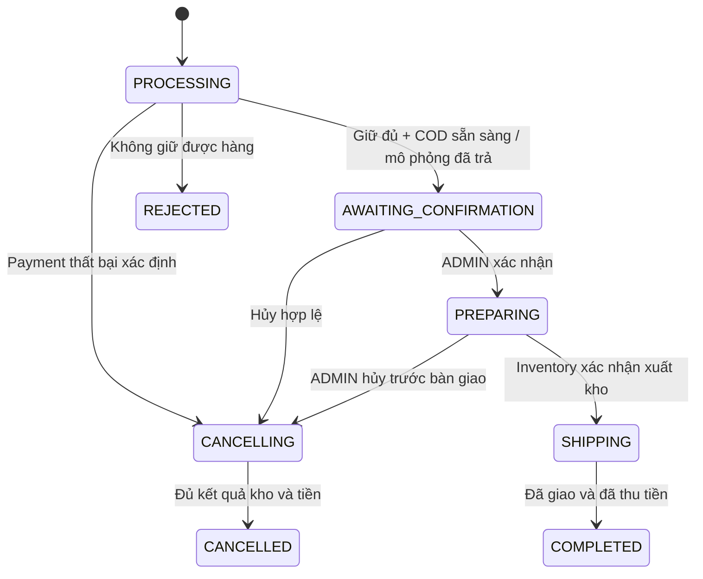
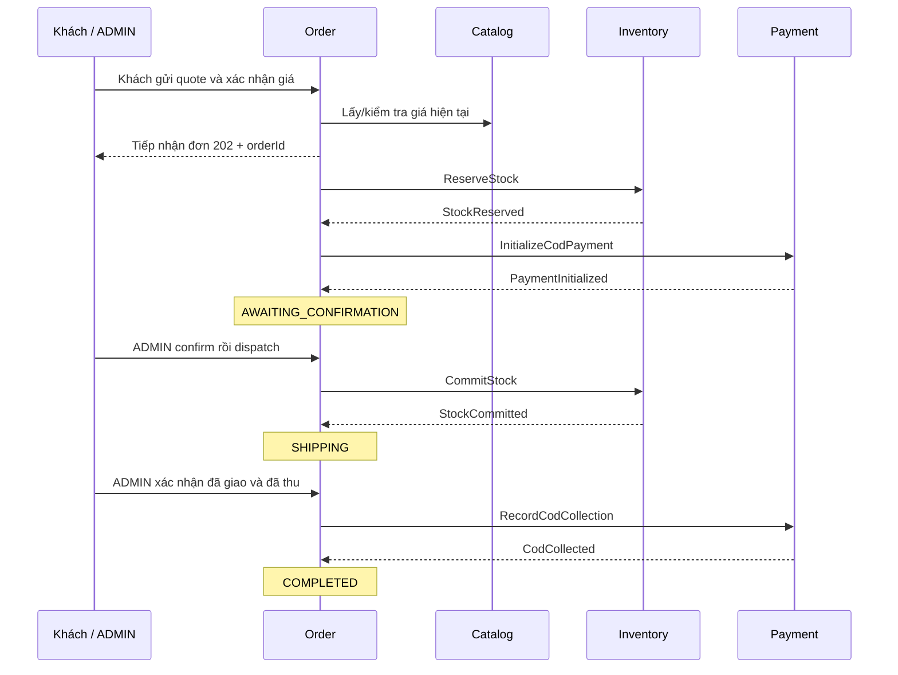

# Step 1 — Hiểu Order và chuẩn bị điểm nối với các service

Người phụ trách: **Mạnh**. Ngày chuẩn bị: **07/11/2026**.

**Trạng thái: PREPARED — đã đối chiếu tài liệu và chuẩn bị mẫu; các mục cần chủ service xác nhận vẫn OPEN.** Chưa chạy nghiệp vụ, seed database, phát message hoặc kiểm thử tích hợp. Bản này là kết quả chuẩn bị của [Step 1 trong plan](plan.md#step-1--hiểu-phạm-vi-và-chốt-điểm-nối-với-các-service), không phải quyết định thay hợp đồng chung.

## 1. Mạnh cần hiểu gì trước khi viết code?

Một đơn là bản ghi về lần mua hàng: ai mua, mua gì, giá nào, giao đâu, trả bằng cách nào và hiện xử lý đến đâu. Order lưu bản chụp thông tin lúc đặt để việc Catalog thay tên/giá sau này không sửa đơn cũ.

Order quyết định trạng thái đơn, nhưng phải dựa vào kết quả của service sở hữu nghiệp vụ liên quan. Ví dụ Order gửi yêu cầu giữ 2 con chuột; Inventory thực hiện rồi báo đã giữ đủ. Với COD, Payment ghi nghĩa vụ phải thu 430.000đ; đến lúc giao thành công và xác nhận thu đủ thì Payment mới ghi đã thu.

| Service | Câu hỏi Order nhờ trả lời | Order trao đổi bằng gì? |
| --- | --- | --- |
| Identity/Gateway | Người gọi là ai, có phải ADMIN không? | Danh tính đã xác thực; cơ chế cụ thể ở ORD-OPEN-01 |
| Catalog | Sản phẩm đang bán không, giá/tên/SKU/version hiện tại là gì? | HTTP `POST /internal/products/batch` |
| Inventory | Có giữ đủ hàng không, đã giải phóng/xuất hàng chưa? | Command/event RabbitMQ; HTTP tra cứu khi phục hồi |
| Payment | Đã tạo COD/thu tiền/hoàn tiền chưa? | Command/event RabbitMQ; HTTP tra cứu khi phục hồi |
| Frontend | Khách/ADMIN cần thấy hoặc thao tác gì tiếp theo? | API qua Gateway, polling detail, `allowedActions` |

**Command** là yêu cầu làm việc, ví dụ `ReserveStock`. **Event** là kết quả đã được service xử lý và commit, ví dụ `StockReserved`. Đã gửi command chưa chứng minh công việc đã xong.

**HTTP 202** khi tạo đơn nghĩa là đã lưu yêu cầu để xử lý tiếp. Nó chưa bảo đảm còn hàng hoặc thanh toán thành công. Khách tiếp tục tra cứu cùng `orderId`.

## 2. Tám trạng thái Order phải nắm

Theo [workflow](../design/THIET-KE-LUONG-XU-LY.md) và enum trong [OpenAPI](../contracts/openapi.yaml):

| Trạng thái | Nghĩa dễ hiểu | Điều kiện/bằng chứng |
| --- | --- | --- |
| `PROCESSING` | Đang kiểm tra và phối hợp giữ hàng/thanh toán | Đơn được tiếp nhận và lưu bền vững; chưa đủ kết quả để chờ cửa hàng xác nhận |
| `AWAITING_CONFIRMATION` | Đã đủ điều kiện, chờ cửa hàng xác nhận | Đã giữ đủ hàng; COD đã khởi tạo hoặc mô phỏng đã SUCCEEDED |
| `PREPARING` | Cửa hàng đã xác nhận, đang chuẩn bị | ADMIN confirm hợp lệ từ AWAITING_CONFIRMATION |
| `SHIPPING` | Đã bàn giao để giao hàng | Inventory báo StockCommitted đúng lệnh dispatch |
| `COMPLETED` | Đã giao thành công và đã thu tiền | Đã xác nhận giao; Payment SUCCEEDED, COD phải có kết quả thu hợp lệ |
| `CANCELLING` | Đang giải phóng hàng và giải quyết nhánh tiền | Yêu cầu hủy hợp lệ, hoặc payment thất bại xác định sau khi giữ hàng |
| `CANCELLED` | Đã xử lý hủy xong | Kho đã giải phóng; COD đã hủy hoặc tiền đã hoàn; trường hợp payment FAILED không có khoản thu để hoàn |
| `REJECTED` | Không thể đáp ứng đơn vì không giữ đủ hàng | StockReservationFailed; không gọi khởi tạo Payment |

Trạng thái tiền thuộc một trục riêng: COD có `AWAITING_COLLECTION`, mô phỏng có `PENDING`, `SUCCEEDED`, `FAILED`, `REFUND_PENDING`, `REFUNDED`... `AWAITING_CONFIRMATION` của Order không đồng nghĩa đã thu tiền COD.

Workflow ghi việc đang làm như CHECKOUT, DISPATCH, COMPLETION hoặc CANCELLATION. Khi chờ StockCommitted, đơn vẫn PREPARING nhưng workflow đang DISPATCH nên phải khóa thao tác hủy xung đột. Không cần thêm một OrderStatus tự đặt tên là DISPATCHING.

## 3. Theo một đơn COD từ đầu đến cuối

Fixture: CUSTOMER_A mua **2 chuột × 200.000đ**, phí ship **30.000đ**, tổng **430.000đ**; tồn đầu 10, đang giữ 0. Giá trị phí này chỉ dành cho ví dụ/test, chưa chốt cho cửa hàng thật.

| Bước | Ai làm? | Đơn/kho/tiền thay đổi thế nào? |
| --- | --- | --- |
| 1. Quote | Order đọc Catalog, tính tổng | Chỉ báo giá; chưa tạo đơn hoặc giữ hàng |
| 2. Submit | Order kiểm tra lại giá, snapshot và lưu key/workflow/outbox | Đơn PROCESSING; trả 202 và orderId |
| 3. ReserveStock -> StockReserved | Inventory giữ đủ 2 | on_hand=10, reserved=2; chưa xuất hàng |
| 4. InitializeCodPayment -> PaymentInitialized | Payment ghi chờ thu 430000 | Payment AWAITING_COLLECTION; Order AWAITING_CONFIRMATION |
| 5. Confirm | ADMIN qua Order | PREPARING; không giữ hàng lần hai |
| 6. Dispatch -> CommitStock -> StockCommitted | Inventory xuất đúng 2 | on_hand=8, reserved=0; Order mới SHIPPING |
| 7. Complete -> RecordCodCollection -> CodCollected | ADMIN xác nhận đã giao/thu, Payment ghi đã thu | Payment SUCCEEDED; Order mới COMPLETED |

Sơ đồ rút gọn bước quote/submit; cả quote và lần tạo mới đều phải đọc/kiểm tra Catalog theo [HTTP contract](../contracts/HTTP-API.md). Trao đổi kho/tiền ở đây là message qua broker; không giữ transaction DB trong khi chờ mạng.

## 4. Những nhánh lỗi Mạnh phải giải thích được

| Tình huống | Order phải làm | Điều không được suy ra |
| --- | --- | --- |
| Không đủ hàng | REJECTED sau StockReservationFailed, không khởi tạo payment | Không giữ một phần giỏ |
| Mô phỏng thành công | Giữ hàng -> ProcessPayment -> PaymentSucceeded -> AWAITING_CONFIRMATION | Đã trả tiền chưa có nghĩa đã giao |
| Mô phỏng thất bại xác định | CANCELLING -> ReleaseStock -> StockReleased -> CANCELLED | Không hoàn tiền khoản chưa thu |
| Payment trả chậm/mất event | Giữ PROCESSING, chờ và đối chiếu cùng ID | Timeout không chứng minh FAILED; không tự release/thu lại |
| Khách hủy COD khi đang chờ xác nhận | ReleaseStock và CancelCodPayment; đủ cả hai mới CANCELLED | Chỉ giải phóng kho chưa đủ kết thúc đơn |
| Khách hủy mô phỏng đã trả | ReleaseStock và RefundPayment đủ 430000; đủ cả hai mới CANCELLED | Không bỏ phí ship khỏi refund trong MVP này |
| Refund lỗi | Giữ CANCELLING/REFUND_PENDING, ghi cờ và retry đúng nhánh | Không giữ hàng lại nếu kho đã RELEASED |
| Hủy cạnh tranh dispatch | Một thao tác thắng theo lock/version và điều kiện workflow | Không vừa RELEASED vừa COMMITTED cùng reservation |
| Khách gửi lại sau mất HTTP | Replay cùng Idempotency-Key/payload trả cùng đơn | Không sinh key mới mỗi lần timeout |
| Giao không thành công | Ghi ngoại lệ, giữ SHIPPING và cờ cần xử lý | Không tự COMPLETED/hoàn tồn/hoàn tiền |

Khách chỉ hủy đơn của mình ở AWAITING_CONFIRMATION; ADMIN được thêm PREPARING, trước dispatch. Các action vẫn phải kiểm tra workflow và payment pending. Người khác xem đơn nhận 404; CUSTOMER không được gọi API ADMIN.

## 5. Bộ fixture đã chuẩn bị

Fixture là dữ liệu mẫu cố định để trao đổi hoặc làm đầu vào test về sau; các file này không tự tạo người dùng, sản phẩm, đơn hoặc message thật.

| File | Nội dung |
| --- | --- |
| [fixtures/data.json](fixtures/data.json) | 3 actor, 4 sản phẩm, giá/phí, người nhận giả và 8 scenario kèm trạng thái/tồn/tiền kỳ vọng |
| [fixtures/http.json](fixtures/http.json) | 8 ví dụ quote, tạo COD/mô phỏng, hủy, confirm, dispatch, complete và exception |
| [fixtures/messages.json](fixtures/messages.json) | 29 ví dụ, bao phủ 8 loại command + 14 loại event, có envelope và exchange/routing key/queue |

Quy tắc sử dụng:

- Mỗi scenario bắt đầu từ baseline riêng; không cộng dồn số tồn giữa các scenario. Dùng fixture test/DB riêng khi triển khai test sau này.
- CUSTOMER_A/B, ADMIN_A là principal giả lập trong test, không phải tài khoản hoặc token đang hoạt động. CUSTOMER_B dùng kiểm thử quyền truy cập đơn CUSTOMER_A.
- Dữ liệu sản phẩm thuộc Catalog, tồn thuộc Inventory, actor thuộc Identity. Order không được seed hoặc ghi chéo schema dưới runtime role của mình.
- Các mẫu message là ví dụ độc lập để review shape/routing; không phát cả file tuần tự. Các event thành công/thất bại cùng operation là nhánh thay thế, không phải kết quả hợp lệ đồng thời.
- `paymentScenario`/`refundScenario` trong data.json là metadata cho người chuẩn bị test cấu hình Payment; chúng không thuộc request checkout hoặc command từ khách.
- ID là UUID cố định, tiền chuỗi VND, quantity integer, thời gian UTC. Phí ship, orderNumber, error code minh họa và dãy paymentVersion chưa phải quyết định production.
- HTTP fixture Step 1 giữ 8 ví dụ ban đầu. Step 7–8 đã triển khai đề xuất `details.quote` và có [ví dụ lỗi](step-8.md#3-price_changed-trả-ở-đâu) để frontend review; chưa coi đồng đội đã xác nhận.

Tám scenario: COD hoàn thành, mô phỏng thành công, thiếu hàng, mô phỏng thất bại, mô phỏng chậm, hủy đã trả, refund lỗi rồi retry, hủy COD. Expected là kết quả mong đợi theo tài liệu, **chưa phải actual/PASS**.

## 6. Các loại ID để tránh nhầm

| Field | Ý nghĩa | Khi gửi lại có đổi không? |
| --- | --- | --- |
| `orderId` | Đơn đang được xử lý | Không đổi trong vòng đời đơn |
| `Idempotency-Key` | Một yêu cầu HTTP của cùng actor/scope/payload | Giữ khi retry; payload khác cần key khác |
| `operationId` | Một công việc nghiệp vụ như giữ hàng, xuất kho, hoàn tiền | Giữ khi retry đúng công việc; không dùng ID giữ hàng làm ID xuất kho |
| `messageId` | Một message được lưu để phát | Retry publish giữ ID; message kết quả mới có ID riêng |
| `correlationId` | Liên kết các bước cùng luồng | Giữ để theo dấu luồng |
| `causationId` | Message đã gây ra message hiện tại | Event trỏ tới command; command do event kích hoạt trỏ tới event đó |
| `version` | Phiên bản schema message | Hiện contract v1; không phải trạng thái Payment |
| `paymentVersion` | Phiên bản dữ liệu tiền | Dùng chặn event cũ; quy tắc tăng và retry refund cần Payment review |

Một operation refund có thể báo lỗi rồi thành công sau retry. Không được bỏ kết quả thành công mới chỉ vì operationId đã từng thấy ở event lỗi. Ngược lại, phát lại cùng một message đã xử lý không được hoàn lần hai.

### 6.1. Phần message đã có căn cứ để dùng ngay

Các dòng sau đã có trong [MESSAGES](../contracts/MESSAGES.md), không phải quy ước mới cần đề xuất lại. Mạnh có thể dùng chúng để viết schema/fixture/test Order ngay.

| Nội dung | Cách dùng theo contract hiện tại | Tình trạng |
| --- | --- | --- |
| UUID | ID đơn, message, operation, correlation, payment/reservation là UUID; fixture hiện dùng UUID v4 cố định | Đã đối chiếu; contract không bắt buộc mọi ID runtime phải là UUID v4 |
| Money string | Tiền trên HTTP/message là chuỗi nguyên không âm, ví dụ `"430000"`, `currency="VND"`; tính nội bộ bằng số nguyên | Đã đối chiếu |
| correlationId | Command và event trong cùng luồng có ID liên kết; event giữ liên kết của command | Đã đối chiếu |
| operationId | Mỗi công việc nghiệp vụ có ID ổn định, retry cùng công việc giữ ID; event trả ID của command đó | Đã đối chiếu |
| messageId | Retry publish cùng message giữ ID; event mới có ID riêng | Đã đối chiếu |
| causationId | Event trỏ command gây ra nó, command do event kích hoạt trỏ event; null khi bắt đầu từ HTTP | Đã đối chiếu |
| version | Schema envelope hiện `version: 1`; consumer cần xử lý version không hỗ trợ theo contract | Đã đối chiếu |
| paymentVersion | Thuộc phiên bản trạng thái Payment, tách khỏi version schema; chặn kết quả cũ | Ý nghĩa đã rõ; quy tắc tăng qua pending/refund retry và error codes vẫn ORD-OPEN-05 |
| Routing | 8 command/14 event dùng exchange/routing/queue hiện có trong topology | Đã đối chiếu mẫu và topology |

Chưa cần họp để chọn lại kiểu UUID, money hoặc version=1 đã có. Việc còn cần chủ Inventory/Payment review là họ có triển khai đúng contract này không, các code lỗi minh họa có đúng không, và kết quả mới của refund retry được phân biệt bằng paymentVersion thế nào. Nếu phát hiện cần đổi field/ý nghĩa thì cập nhật hợp đồng chung cùng producer/consumer trước khi ghép luồng đó.

### 6.2. Mapping HTTP/worker đã chuẩn bị và thông tin còn thiếu

Phương án áp dụng cho Order là chạy các ứng dụng trên **cùng một laptop bằng Docker Compose**. Địa chỉ dưới đây lấy từ settings, `.env.example` và Compose; cột native hỗ trợ debug riêng, cột Compose dùng để tích hợp các container. Kết quả API/DB/broker test thật được ghi riêng ở [Step 2](step-2.md), không suy ra mọi API nghiệp vụ đã chạy.

| Thành phần | Chạy native trên cùng máy | Trong mạng Compose dev |
| --- | --- | --- |
| Gateway | `http://127.0.0.1:3000` | `http://api-gateway:3000` |
| Identity | `http://127.0.0.1:3001` | `http://identity-service:3001` |
| Catalog | `http://127.0.0.1:3002` | `http://catalog-service:3002` |
| Inventory | `http://127.0.0.1:3003` | `http://inventory-service:3003` |
| Order | `http://127.0.0.1:3004` | `http://order-service:3004` |
| Payment | `http://127.0.0.1:3005` | `http://payment-service:3005` |

Container dùng hostname Compose, ví dụ Order gọi Catalog tại `http://catalog-service:3002`; trình duyệt trên laptop vào cổng publish localhost. Các worker dùng RabbitMQ của cùng stack. Không cần chốt IP các laptop. Gateway mới có CATALOG_BASE_URL cho diagnostic; routing nghiệp vụ Order và các HTTP client internal vẫn cần triển khai, không chỉ điền thêm URL vào file env là có.

| Việc cần người thực hiện | Phần đã xác định được | Còn cần nhóm cung cấp |
| --- | --- | --- |
| Gateway/auth | Phối hợp với người phụ trách Identity/Gateway; bảng phân công cũ gọi là vị trí 1 nhưng chưa có tên | Tên người hiện nhận việc và cơ chế auth thực tế; chưa gán Mạnh hoặc người khác thay nhóm |
| Consumer/outbox/recovery Order | Nghiệp vụ thuộc phần Order Mạnh phụ trách, chạy cùng laptop/stack | Thêm container/entrypoint sau khi viết handler ở Step 9/14; không cần chọn máy khác |
| Worker Inventory/Payment | Thuộc chủ Inventory/Payment, chạy cùng stack và RabbitMQ | Code handler và entrypoint tương thích để đưa vào Compose |
| Host các API | Dùng hostname Compose và port có trong bảng | Kiểm tra routing/client khi triển khai endpoint; không cần URL liên laptop |

Không cần chờ phân công máy để làm domain/schema/unit test. Hiện worker mới là monitor; consumer/outbox/recovery được thêm vào Compose sau khi có handler. Step 2 dùng DB/broker test riêng, không cho worker thử nghiệm quét dữ liệu Supabase chung.

## 7. Register điểm cần phối hợp

`EXISTING CONTRACT` là quy tắc đã có trong bộ tài liệu hiện tại, không tuyên bố cả nhóm vừa duyệt. `OPEN` chưa có thông tin đủ để tích hợp; `PROPOSED` là phương án Mạnh có thể mang đi review. Chưa biết tên các thành viên khác, nên người phối hợp được ghi theo vai trò. Không có tin nhắn nào được gửi cho họ trong bước này.

| Mã | Trạng thái | Cần trả lời/chuẩn bị cụ thể | Chủ trì và phối hợp | Chặn phần nào? |
| --- | --- | --- | --- | --- |
| ORD-OPEN-01 | OPEN cho adapter thật | Step 6 đã có verifier seam đóng mặc định và test chống spoof. Còn cần contract xác minh token: claim user/role, issuer/audience/public key/JWKS hoặc API kiểm tra; test principal chỉ qua dependency override | Identity + Gateway; Mạnh review | Token/login thật ở Step 6 còn chưa hoàn thành |
| ORD-OPEN-02 | PARTIAL | Step 7 có [OpenAPI internal dự thảo](../contracts/catalog-internal.openapi.yaml), caller/test và URL native/Compose; chờ chủ Catalog xác nhận shape/lỗi/auth, triển khai batch và cấp credential thật | Catalog; Mạnh review caller | Tích hợp Catalog thật, step 7 |
| ORD-OPEN-03 | IMPLEMENTED trong Order Step 4 | Đã thêm `order_workflows.reservation_id` UUID nullable và cập nhật thiết kế DB; đây là dữ liệu tham chiếu Order tự lưu theo field reservationId đã có trong message. Đối chiếu response Inventory khi tích hợp | Mạnh; Inventory đối chiếu field theo contract | Không chặn model/migration; xác minh message thật ở Step 10 |
| ORD-OPEN-04 | PARTIAL | Step 14 đã có [OpenAPI recovery dự thảo](../contracts/order-recovery.openapi.yaml), caller/job và test snapshot/receipt gốc; chờ producer xác nhận/triển khai response, token và kiểm thử thật. 404/timeout không chứng minh command chưa chạy | Inventory + Payment; Mạnh review | Tích hợp recovery thật, step 14/15 |
| ORD-OPEN-05 | OPEN | Version bắt đầu/tăng khi nào? Refund retry cùng operation có kết quả mới được nhận diện bằng gì? Error codes chính thức? Review toàn bộ mẫu event | Payment + Inventory; Mạnh review consumer | Event guards/recovery, step 9–14 |
| ORD-OPEN-06 | PARTIAL | Step 14 đã phản chiếu PENDING bằng snapshot khớp command/operation/amount và test không thu lại. Chờ Payment xác nhận shape/auth thực tế; chưa biết thì paymentId/status vẫn null, không bịa kết quả | Payment + Mạnh + frontend | Tích hợp view pending/recovery |
| ORD-OPEN-07 | EXISTING CONTRACT | `/complete` trả 202, `Order.history` là tên field public; giữ OpenAPI hiện tại khi code | Mạnh + Gateway/frontend | Không chặn; chỉ đổi nếu cập nhật contract cùng nhau |
| ORD-OPEN-08 | PARTIAL | Step 7–8 đã mở rộng ServiceError và test PRICE_CHANGED ở `details.quote` qua Gateway; chờ frontend/reviewer xác nhận shape và UX xác nhận giá mới | Mạnh + frontend + reviewer shared | Phối hợp frontend, step 7/8 |
| ORD-OPEN-09 | OPEN | Broker down: Gateway có cho tạo đơn bền vững bằng outbox khi DB/Catalog vẫn sẵn sàng? Endpoint readiness nào dùng để routing? | Gateway/hạ tầng + Mạnh | Availability và fault test, step 8/14 |
| ORD-OPEN-10 | PARTIAL | Step 5 có mã UUID hex hoa 32 ký tự; Step 6 q tìm trong mã. Step 7 có SHIPPING_FEE_AMOUNT nhưng chưa đặt giá mặc định; nhóm cần chốt mức phí thật. Định dạng mã/tìm kiếm khác cần thống nhất trước khi đổi | Nhóm + Mạnh + frontend | Phí ship ở Step 7; tìm mã hiện tại đã dùng được |
| ORD-OPEN-11 | RESOLVED về topology | Tất cả ứng dụng/worker chạy trên một laptop/Compose, dùng hostname nội bộ và RabbitMQ cùng stack. Compose worker nghiệp vụ bổ sung sau khi có handler; DB/broker test tách riêng | Mạnh + các chủ service bổ sung entrypoint phần mình | Không còn việc chọn máy/URL liên laptop; triển khai worker thuộc Step 9/14 |

ORD-OPEN-03 đã triển khai trong schema Order và cập nhật thiết kế DB ở Step 4, không tuyên bố đã review implementation Inventory. ORD-OPEN-02/08 đã có code phía Order theo dự thảo, chưa có xác nhận của đồng đội. Khi một lựa chọn đổi hợp đồng producer/consumer, cập nhật cùng các bên liên quan; lưu reservationId nội bộ không đổi message hoặc schema Inventory.

### Nội dung Mạnh có thể dùng trong buổi trao đổi nhóm

1. **Identity/Gateway:** thống nhất dữ liệu danh tính đã xác thực Order nhận và URL routing; chưa dùng header user/role tự khai báo làm auth.
2. **Catalog:** cùng xem fixture HTTP, chốt batch lấy giá hiện tại và xử lý sản phẩm không bán được.
3. **Inventory:** xem Reserve/Release/Commit, mẫu reservationId và API đối chiếu; rà code lỗi minh họa.
4. **Payment:** xem COD/mô phỏng/refund, amount 430000, version/null pending và retry cùng operation; rà code lỗi minh họa.
5. **Người phụ trách Compose/DB:** chạy ứng dụng và worker cùng laptop/stack; cấp cấu hình Supabase Order ngoài Git, kiểm tra quyền và người áp dụng migration theo [Step 2](step-2.md).

Chỉ cần ghi tên người nhận việc và kết luận kỹ thuật; không cần đưa mật khẩu, token hoặc connection string có secret vào tài liệu này. Khi có kết luận, cập nhật status/người xác nhận/ngày và tài liệu nguồn liên quan trong cùng thay đổi.

## 8. Đối chiếu và tình trạng thực hiện Step 1

Đã đối chiếu: BR-01–12, UC-ORD-01–04, UC-ADM-02–04 trong [nghiệp vụ](../product/DAC-TA-NGHIEP-VU.md); 8 trạng thái và các nhánh trong [workflow](../design/THIET-KE-LUONG-XU-LY.md); cấu trúc public trong [HTTP](../contracts/HTTP-API.md)/[OpenAPI](../contracts/openapi.yaml); 8 command/14 event trong [MESSAGES](../contracts/MESSAGES.md); F.12–16 và F.20–23 trong [thiết kế DB](../design/MO-TA-HE-THONG.md); đối chiếu expected với [AT](../testing/KE-HOACH-KIEM-THU.md).

Code nền đã xem: Order `main.py`/`worker.py`, Gateway diagnostic và envelope/topology trong backend-common. Hiện chưa có auth/router nghiệp vụ/consumer Order; tài liệu này không khẳng định API mẫu đang phục vụ thật.

Đã kiểm tra tĩnh ba JSON: đọc/parse hợp lệ, UUID/money/quantity đúng quy ước, 8 scenario có orderId riêng, đủ 8 command và 14 event, đủ field payload được liệt kê trong contract, routing/queue nhất quán, liên kết causation/operation của event đúng command mẫu và tổng tiền 430000. Đây là kiểm tra dữ liệu mẫu; chưa kiểm thử handler, HTTP server, DB hoặc broker. Error code minh họa và quy tắc paymentVersion vẫn cần chủ service review.

| Đầu việc Step 1 | Kết quả |
| --- | --- |
| Đọc/ghi 8 trạng thái và các luồng | Đã chuẩn bị ở mục 1–4; Mạnh đọc để nắm nghiệp vụ |
| Chuẩn bị actor/sản phẩm/phí/scenario | Có 3 JSON fixture, dữ liệu giả lập, chưa seed |
| Xử lý bảng điểm nối | Đã lập register và người phối hợp theo vai trò; quyết định nhóm còn OPEN |
| Đối chiếu quy ước và mẫu message | Đã xong phần kỹ thuật ở mục 6.1; UUID/money/ID/schema version có thể dùng ngay theo contract hiện tại |
| Xác nhận producer/consumer | Cần review sự tương thích của implementation, code lỗi và paymentVersion/refund; ORD-OPEN-05 còn OPEN |
| Chuẩn bị mapping HTTP/worker | Đã ghi port/URL native/Compose và vai trò cần phối hợp ở mục 6.2 |
| Topology/URL/worker | Đã xác định cùng laptop/Compose; ORD-OPEN-11 resolved về topology, handler/container worker triển khai ở các bước sau |
| Auth | Cơ chế xác thực và người phối hợp Identity/Gateway còn ORD-OPEN-01; độc lập với việc chọn máy |

**Step 1 chưa được đánh dấu hoàn tất toàn bộ.** Phần chuẩn bị đã có để Mạnh đọc và review; các xác nhận liên service chưa được thực hiện. Việc có thể làm tiếp là Step 2 kiểm tra môi trường, Step 3 domain/schema; riêng lựa chọn DB/auth/message còn OPEN phải giữ rõ trạng thái đề xuất khi triển khai phần phụ thuộc.
